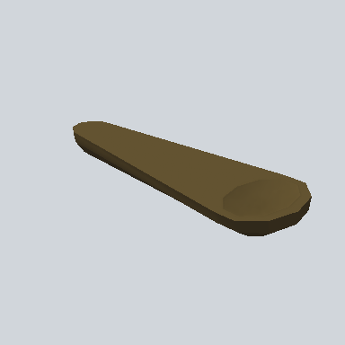

# EA_Items_House_spoon_wooden_05_PRE

Generated by `tools/assets/gen_prefab_tables.py`: edit only below the Notes heading.

| Field | Value |
| --- | --- |
| Pack | EmaceArt-SlavicWorldFree |
| Path | `Prefabs/Items/Crockery/EA_Items_House_spoon_wooden_05_PRE.prefab` |
| GUID | `333fb13d0b193244a96f53a4fcebbb07` |
| Subgroup | Crockery |
| Size (m) | 0.3 |
| Collider | none |
| LODs | 3 |
| Meshes | `EA_Items_House_spoon_wooden_05.fbx` |
| Materials | `EA03_LPNP-Slavika_Colorsheet_v1.mat` |
| Nested prefabs | none |
| In demo scene | 1 |
| Bounds W x H x D (m) | 0.10 x 0.03 x 0.29 |
| Footprint (m) | 0.1 x 0.3 |
| Pivot | bottom at y = -0.00; center offset x -0.00, z -0.04 |
| Triangles / vertices (LOD0) | 96 / 116 |
| Average color | `#58492B` |
| Dominant colors | `#625230` 68%, `#332B1B` 19%, `#5B4C2C` 11% |

Colors are read from the rendered preview, so they include lighting. Bounds cover LOD0 renderers.

## Notes

TODO: hand-written usage notes.
