# Items

**Prefabs: 31**

Small hand-held and shelf objects for interiors. Every prefab has its own card; see [Prefabs](#prefabs).

| Subgroup | Count | Size (m) | What it is |
| --- | --- | --- | --- |
| `Crockery` | 23 | 0.2 - 0.6 | bottle, cup, bowl, spoon, pan, kettle; 5 have no collider |
| `House` | 6 | 0.7 - 3.5 | besom, firewood, hanger, ceiling crate |
| `Food` | 1 | 0.2 | apple |
| `Tool` | 1 | 0.9 | pick |

## Using it in a map

- Interior dressing only; these are too small to read in an outdoor map. The
  demo scene uses 21 instances of them.
- Skip this category for the first environment pass.

## Prefabs

<!-- PREFAB-INDEX:START (generated) -->

**31 prefabs**, one card each.

| Preview | Subgroup | Prefab | W x H x D (m) | Main color | In scene |
| --- | --- | --- | --- | --- | --- |
| 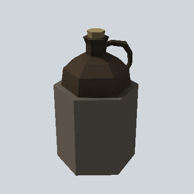 | Crockery | [EA03_Items_House_Bottle_01a_PRE](Crockery/EA03_Items_House_Bottle_01a_PRE.md) | 0.3 x 0.5 x 0.3 | `#38332E` | 2 |
|  | Crockery | [EA03_Items_House_BredBoard_01a_PRE](Crockery/EA03_Items_House_BredBoard_01a_PRE.md) | 0.3 x 0.0 x 0.6 | `#6E625A` | - |
| 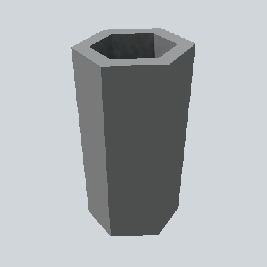 | Crockery | [EA03_Items_House_Cup_01a_PRE](Crockery/EA03_Items_House_Cup_01a_PRE.md) | 0.1 x 0.2 x 0.1 | `#4D4E4E` | 1 |
| 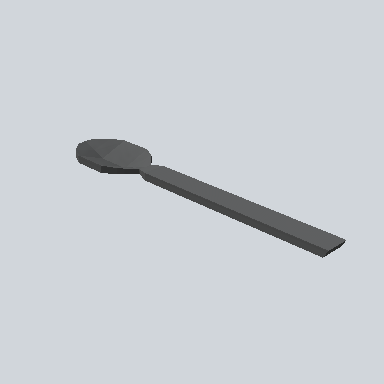 | Crockery | [EA03_Items_House_Spoon_01a_PRE](Crockery/EA03_Items_House_Spoon_01a_PRE.md) | 0.1 x 0.0 x 0.4 | `#5E6060` | 1 |
| 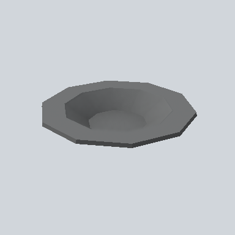 | Crockery | [EA_Items_House_bowl_metal_PRE](Crockery/EA_Items_House_bowl_metal_PRE.md) | 0.3 x 0.1 x 0.3 | `#6F7071` | 2 |
| 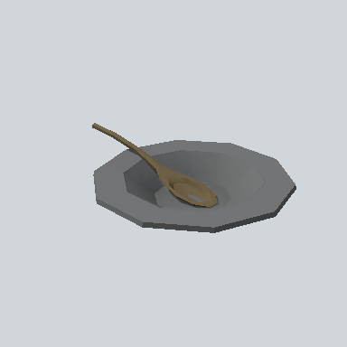 | Crockery | [EA_Items_House_bowl_spoon_01a_PRE](Crockery/EA_Items_House_bowl_spoon_01a_PRE.md) | 0.3 x 0.1 x 0.4 | `#6F7071` | - |
| 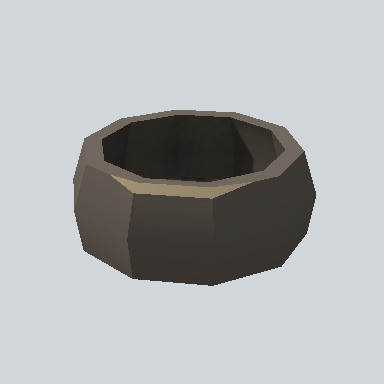 | Crockery | [EA_Items_House_bowl_wod_2_PRE](Crockery/EA_Items_House_bowl_wod_2_PRE.md) | 0.2 x 0.1 x 0.2 | `#36322D` | 1 |
|  | Crockery | [EA_Items_House_bowl_wod_PRE](Crockery/EA_Items_House_bowl_wod_PRE.md) | 0.4 x 0.1 x 0.4 | `#96855B` | - |
|  | Crockery | [EA_Items_House_bowl_wooden_powder_02a_PRE](Crockery/EA_Items_House_bowl_wooden_powder_02a_PRE.md) | 0.2 x 0.3 x 0.4 | `#342D27` | 1 |
|  | Crockery | [EA_Items_House_cauldron_01a_PRE](Crockery/EA_Items_House_cauldron_01a_PRE.md) | 0.4 x 0.5 x 0.3 | `#423D38` | - |
| 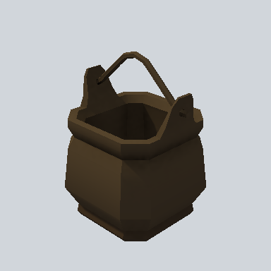 | Crockery | [EA_Items_House_cauldron_01d_PRE](Crockery/EA_Items_House_cauldron_01d_PRE.md) | 0.3 x 0.5 x 0.3 | `#2C2419` | - |
|  | Crockery | [EA_Items_House_cauldron_soup_01a_PRE](Crockery/EA_Items_House_cauldron_soup_01a_PRE.md) | 0.5 x 0.4 x 0.5 | `#151515` | - |
|  | Crockery | [EA_Items_House_kettle_01a_PRE](Crockery/EA_Items_House_kettle_01a_PRE.md) | 0.3 x 0.3 x 0.3 | `#302A24` | - |
| 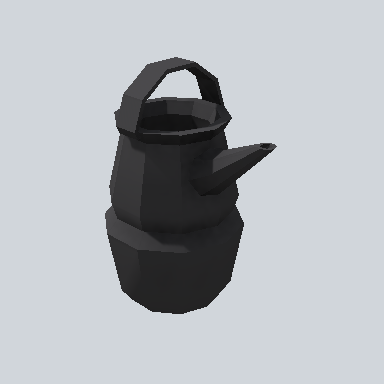 | Crockery | [EA_Items_House_kettle_empty_01a_PRE](Crockery/EA_Items_House_kettle_empty_01a_PRE.md) | 0.2 x 0.4 x 0.4 | `#282729` | 1 |
|  | Crockery | [EA_Items_House_mug_01a_PRE](Crockery/EA_Items_House_mug_01a_PRE.md) | 0.1 x 0.2 x 0.2 | `#2C2C2D` | - |
|  | Crockery | [EA_Items_House_mug_01b_PRE](Crockery/EA_Items_House_mug_01b_PRE.md) | 0.2 x 0.3 x 0.3 | `#19232B` | 1 |
| 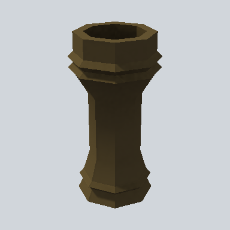 | Crockery | [EA_Items_House_mug_02a_PRE](Crockery/EA_Items_House_mug_02a_PRE.md) | 0.2 x 0.3 x 0.2 | `#30281A` | - |
| 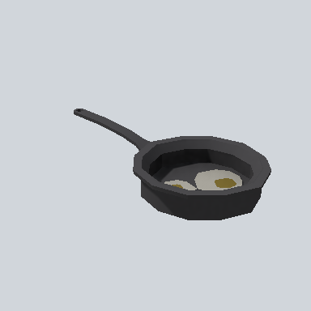 | Crockery | [EA_Items_House_pan_empty_01a_PRE](Crockery/EA_Items_House_pan_empty_01a_PRE.md) | 0.2 x 0.1 x 0.5 | `#2C2B2C` | 1 |
| 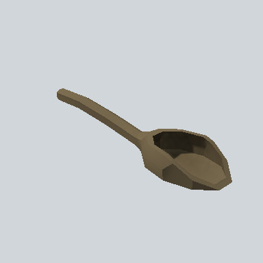 | Crockery | [EA_Items_House_spoon_wooden_02_PRE](Crockery/EA_Items_House_spoon_wooden_02_PRE.md) | 0.1 x 0.1 x 0.4 | `#75664B` | - |
| 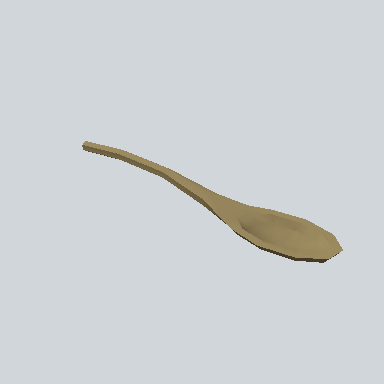 | Crockery | [EA_Items_House_spoon_wooden_03_PRE](Crockery/EA_Items_House_spoon_wooden_03_PRE.md) | 0.1 x 0.0 x 0.3 | `#97865C` | 1 |
|  | Crockery | [EA_Items_House_spoon_wooden_04_PRE](Crockery/EA_Items_House_spoon_wooden_04_PRE.md) | 0.1 x 0.0 x 0.4 | `#796A4E` | - |
|  | Crockery | [EA_Items_House_spoon_wooden_05_PRE](Crockery/EA_Items_House_spoon_wooden_05_PRE.md) | 0.1 x 0.0 x 0.3 | `#625230` | 1 |
| 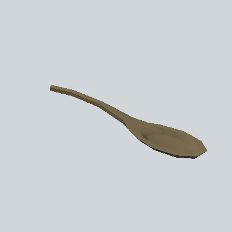 | Crockery | [EA_Items_House_spoon_wooden_PRE](Crockery/EA_Items_House_spoon_wooden_PRE.md) | 0.1 x 0.0 x 0.3 | `#76674C` | - |
|  | Food | [EA03_Items_House_Apple_01c_PRE](Food/EA03_Items_House_Apple_01c_PRE.md) | 0.2 x 0.2 x 0.2 | `#282D17` | - |
| 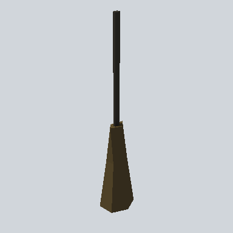 | House | [EA03_Items_House_Besom_01a_PRE](House/EA03_Items_House_Besom_01a_PRE.md) | 0.3 x 1.6 x 0.3 | `#322A1B` | 1 |
| 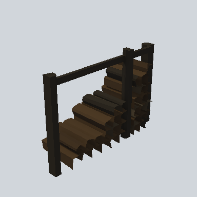 | House | [EA03_Items_House_Firewood_01a_PRE](House/EA03_Items_House_Firewood_01a_PRE.md) | 3.5 x 2.4 x 1.2 | `#1A1714` | - |
| 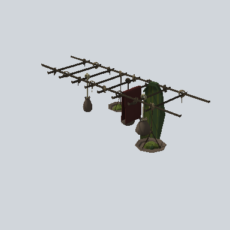 | House | [EA03_Prop_Crate_Under_Ceiling_01b_PRE](House/EA03_Prop_Crate_Under_Ceiling_01b_PRE.md) | 1.1 x 1.2 x 2.9 | `#343024` | 1 |
| 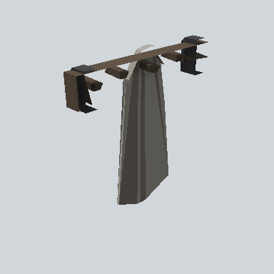 | House | [EA03_Prop_House_Hanger_01b_PRE](House/EA03_Prop_House_Hanger_01b_PRE.md) | 1.2 x 1.2 x 0.2 | `#575550` | 2 |
| 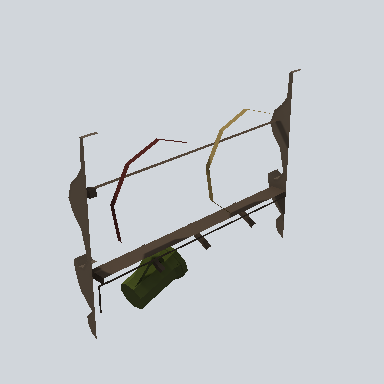 | House | [EA03_Prop_House_Shelf_01g_PRE](House/EA03_Prop_House_Shelf_01g_PRE.md) | 1.6 x 1.1 x 0.2 | `#473C32` | - |
| 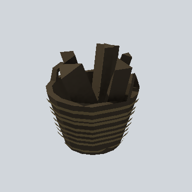 | House | [EA03_Prop_Tool_Basket_01_PRE](House/EA03_Prop_Tool_Basket_01_PRE.md) | 0.6 x 0.7 x 0.7 | `#443B2A` | 2 |
| 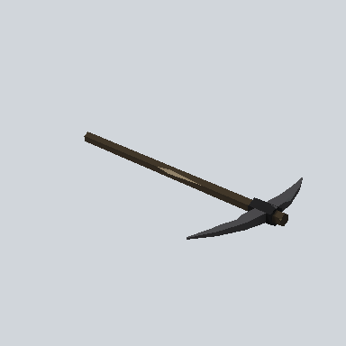 | Tool | [EA03_Prop_Tool_Pick_01a_PRE](Tool/EA03_Prop_Tool_Pick_01a_PRE.md) | 0.6 x 0.1 x 0.9 | `#403629` | 2 |

<!-- PREFAB-INDEX:END -->
