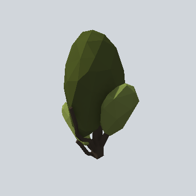

# EA03_Nature_Bush_02a_PRE

Generated by `tools/assets/gen_prefab_tables.py`: edit only below the Notes heading.

| Field | Value |
| --- | --- |
| Pack | EmaceArt-SlavicWorldFree |
| Path | `Prefabs/Nature/Bushes/EA03_Nature_Bush_02a_PRE.prefab` |
| GUID | `a03ab4b398d4be2419fb1eb53e6aef65` |
| Subgroup | Bushes |
| Size (m) | 3.7 |
| Collider | none |
| LODs | 3 |
| Meshes | `EA03_Nature_Bush_02a.fbx` |
| Materials | `EA03_LPNP-Slavika_Colorsheet_v1.mat` |
| Nested prefabs | none |
| In demo scene | 0 |
| Bounds W x H x D (m) | 2.22 x 3.66 x 2.58 |
| Footprint (m) | 2.2 x 2.6 |
| Pivot | bottom at y = 0.00; center offset x -0.02, z 0.07 |
| Triangles / vertices (LOD0) | 472 / 1,194 |
| Average color | `#353B1D` |
| Dominant colors | `#272C16` 44%, `#485224` 19%, `#3C4422` 13% |

Colors are read from the rendered preview, so they include lighting. Bounds cover LOD0 renderers.

## Notes

TODO: hand-written usage notes.
