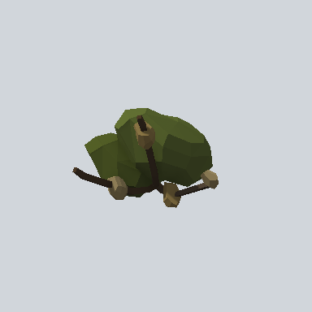

# EA03_Nature_Bush_03a_PRE

Generated by `tools/assets/gen_prefab_tables.py`: edit only below the Notes heading.

| Field | Value |
| --- | --- |
| Pack | EmaceArt-SlavicWorldFree |
| Path | `Prefabs/Nature/Bushes/EA03_Nature_Bush_03a_PRE.prefab` |
| GUID | `c81ddac14e06bd74aa5cebb160dd3fc1` |
| Subgroup | Bushes |
| Size (m) | 2.8 |
| Collider | none |
| LODs | 3 |
| Meshes | `EA03_Nature_Bush_03a.fbx` |
| Materials | `EA03_LPNP-Slavika_Colorsheet_v1.mat` |
| Nested prefabs | none |
| In demo scene | 0 |
| Bounds W x H x D (m) | 2.72 x 1.73 x 2.75 |
| Footprint (m) | 2.7 x 2.7 |
| Pivot | bottom at y = -0.14; center offset x 0.00, z 0.23 |
| Triangles / vertices (LOD0) | 712 / 1,598 |
| Average color | `#3E4221` |
| Dominant colors | `#2E3319` 36%, `#4C5128` 28%, `#231C15` 7% |

Colors are read from the rendered preview, so they include lighting. Bounds cover LOD0 renderers.

## Notes

TODO: hand-written usage notes.
