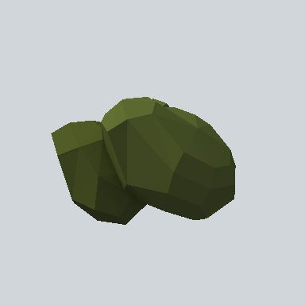

# EA03_Nature_Bush_03c_PRE

Generated by `tools/assets/gen_prefab_tables.py`: edit only below the Notes heading.

| Field | Value |
| --- | --- |
| Pack | EmaceArt-SlavicWorldFree |
| Path | `Prefabs/Nature/Bushes/EA03_Nature_Bush_03c_PRE.prefab` |
| GUID | `9c3c50b49e2f6064aae0377ac612b18d` |
| Subgroup | Bushes |
| Size (m) | 1.9 |
| Collider | none |
| LODs | 3 |
| Meshes | `EA03_Nature_Bush_03c.fbx` |
| Materials | `EA03_LPNP-Slavika_Colorsheet_v1.mat` |
| Nested prefabs | none |
| In demo scene | 0 |
| Bounds W x H x D (m) | 1.91 x 1.43 x 1.83 |
| Footprint (m) | 1.9 x 1.8 |
| Pivot | bottom at y = 0.00; center offset x 0.00, z -0.00 |
| Triangles / vertices (LOD0) | 362 / 960 |
| Average color | `#3A431F` |
| Dominant colors | `#2D3419` 44%, `#475124` 23%, `#3D4621` 18% |

Colors are read from the rendered preview, so they include lighting. Bounds cover LOD0 renderers.

## Notes

TODO: hand-written usage notes.
