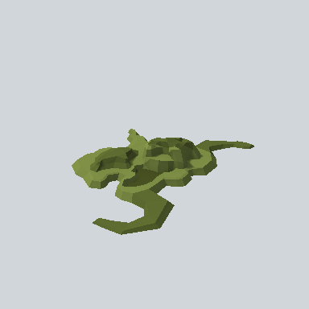

# EA03_Nature_Bush_03d_PRE

Generated by `tools/assets/gen_prefab_tables.py`: edit only below the Notes heading.

| Field | Value |
| --- | --- |
| Pack | EmaceArt-SlavicWorldFree |
| Path | `Prefabs/Nature/Bushes/EA03_Nature_Bush_03d_PRE.prefab` |
| GUID | `94d2beb49de72264f9fc5cc1af32f5b8` |
| Subgroup | Bushes |
| Size (m) | 4.5 |
| Collider | Mesh |
| LODs | 3 |
| Meshes | `EA03_Nature_Bush_03d.fbx` |
| Materials | `EA03_LPNP-Slavika_Colorsheet_v1.mat` |
| Nested prefabs | none |
| In demo scene | 0 |
| Bounds W x H x D (m) | 4.45 x 0.54 x 3.35 |
| Footprint (m) | 4.4 x 3.3 |
| Pivot | bottom at y = -0.01; center offset x -0.12, z 0.09 |
| Triangles / vertices (LOD0) | 596 / 1,146 |
| Average color | `#5D6A32` |
| Dominant colors | `#475126` 29%, `#5C6930` 27%, `#7B8C44` 23% |

Colors are read from the rendered preview, so they include lighting. Bounds cover LOD0 renderers.

## Notes

TODO: hand-written usage notes.
