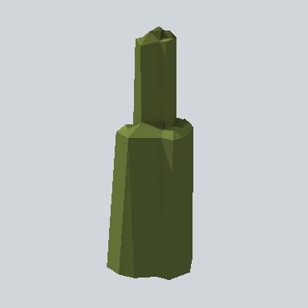

# EA03_Nature_Bush_05b_PRE

Generated by `tools/assets/gen_prefab_tables.py`: edit only below the Notes heading.

| Field | Value |
| --- | --- |
| Pack | EmaceArt-SlavicWorldFree |
| Path | `Prefabs/Nature/Bushes/EA03_Nature_Bush_05b_PRE.prefab` |
| GUID | `47ac1a31f245fb9458ba4f543b4127c0` |
| Subgroup | Bushes |
| Size (m) | 5.9 |
| Collider | Mesh |
| LODs | 3 |
| Meshes | `EA03_Nature_Bush_05b.fbx` |
| Materials | `EA03_LPNP-Slavika_Colorsheet_v1.mat` |
| Nested prefabs | none |
| In demo scene | 0 |
| Bounds W x H x D (m) | 2.13 x 5.92 x 2.03 |
| Footprint (m) | 2.1 x 2.0 |
| Pivot | bottom at y = -0.07; center offset x 0.15, z 0.07 |
| Triangles / vertices (LOD0) | 190 / 458 |
| Average color | `#475128` |
| Dominant colors | `#414A25` 66%, `#626F36` 15%, `#3E4723` 13% |

Colors are read from the rendered preview, so they include lighting. Bounds cover LOD0 renderers.

## Notes

TODO: hand-written usage notes.
