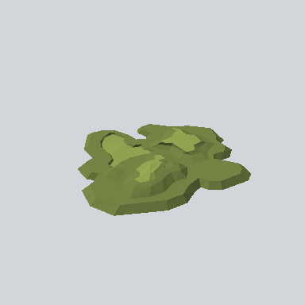

# EA03_Nature_Bush_Flat_03d_PRE

Generated by `tools/assets/gen_prefab_tables.py`: edit only below the Notes heading.

| Field | Value |
| --- | --- |
| Pack | EmaceArt-SlavicWorldFree |
| Path | `Prefabs/Nature/Bushes/EA03_Nature_Bush_Flat_03d_PRE.prefab` |
| GUID | `ad903848e96267a4899e12e333014f94` |
| Subgroup | Bushes |
| Size (m) | 5.1 |
| Collider | Mesh |
| LODs | 3 |
| Meshes | `EA03_Nature_Bush_Flat_03d.fbx` |
| Materials | `EA03_LPNP-Slavika_Colorsheet_v1.mat` |
| Nested prefabs | none |
| In demo scene | 0 |
| Bounds W x H x D (m) | 5.11 x 0.40 x 4.71 |
| Footprint (m) | 5.1 x 4.7 |
| Pivot | bottom at y = -0.06; center offset x -0.12, z -0.23 |
| Triangles / vertices (LOD0) | 477 / 1,069 |
| Average color | `#727F41` |
| Dominant colors | `#758344` 53%, `#66723B` 14%, `#92A250` 12% |

Colors are read from the rendered preview, so they include lighting. Bounds cover LOD0 renderers.

## Notes

TODO: hand-written usage notes.
