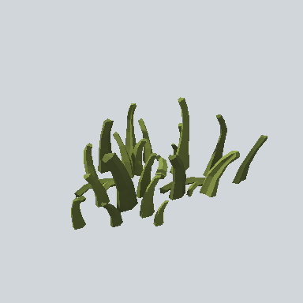

# EA03_Plant_Grass_01e_PRE

Generated by `tools/assets/gen_prefab_tables.py`: edit only below the Notes heading.

| Field | Value |
| --- | --- |
| Pack | EmaceArt-SlavicWorldFree |
| Path | `Prefabs/Nature/Grass/EA03_Plant_Grass_01e_PRE.prefab` |
| GUID | `99e86460e9bfcf644956d799c342fee2` |
| Subgroup | Grass |
| Size (m) | 1.7 |
| Collider | none |
| LODs | 3 |
| Meshes | `EA03_Plant_Grass_01e.fbx` |
| Materials | `EA03_LPNP-Slavika_Colorsheet_v1.mat` |
| Nested prefabs | none |
| In demo scene | 344 |
| Bounds W x H x D (m) | 1.70 x 0.68 x 1.25 |
| Footprint (m) | 1.7 x 1.3 |
| Pivot | bottom at y = -0.01; center offset x -0.04, z 0.04 |
| Triangles / vertices (LOD0) | 1,136 / 2,252 |
| Average color | `#4E572B` |
| Dominant colors | `#474F27` 31%, `#3B4322` 17%, `#687439` 13% |

Colors are read from the rendered preview, so they include lighting. Bounds cover LOD0 renderers.

## Notes

TODO: hand-written usage notes.
