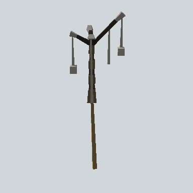

# EA03_Nature_SweetFlag_01e_PRE

Generated by `tools/assets/gen_prefab_tables.py`: edit only below the Notes heading.

| Field | Value |
| --- | --- |
| Pack | EmaceArt-SlavicWorldFree |
| Path | `Prefabs/Nature/Plant/EA03_Nature_SweetFlag_01e_PRE.prefab` |
| GUID | `418e2421d73e25d4cae49958115aafea` |
| Subgroup | Plant |
| Size (m) | 2.8 |
| Collider | none |
| LODs | 3 |
| Meshes | `EA03_Nature_SweetFlag_01e.fbx` |
| Materials | `EA03_LPNP-Slavika_Colorsheet_v1.mat` |
| Nested prefabs | none |
| In demo scene | 0 |
| Bounds W x H x D (m) | 0.78 x 2.82 x 0.64 |
| Footprint (m) | 0.8 x 0.6 |
| Pivot | bottom at y = -0.00; center offset x -0.06, z -0.04 |
| Triangles / vertices (LOD0) | 280 / 560 |
| Average color | `#49453B` |
| Dominant colors | `#565550` 38%, `#383125` 15%, `#4B4027` 15% |

Colors are read from the rendered preview, so they include lighting. Bounds cover LOD0 renderers.

## Notes

TODO: hand-written usage notes.
