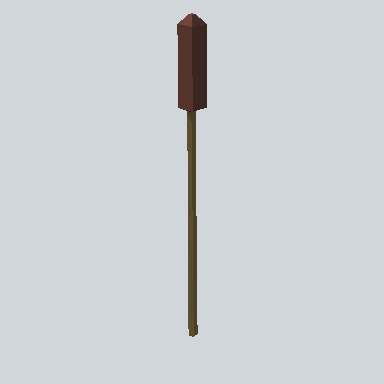

# EA03_Nature_SweetFlag_02a_PRE

Generated by `tools/assets/gen_prefab_tables.py`: edit only below the Notes heading.

| Field | Value |
| --- | --- |
| Pack | EmaceArt-SlavicWorldFree |
| Path | `Prefabs/Nature/Plant/EA03_Nature_SweetFlag_02a_PRE.prefab` |
| GUID | `d421783df02613f419f42f64015b9390` |
| Subgroup | Plant |
| Size (m) | 3.0 |
| Collider | none |
| LODs | 3 |
| Meshes | `EA03_Nature_SweetFlag_02a.fbx` |
| Materials | `EA03_LPNP-Slavika_Colorsheet_v1.mat` |
| Nested prefabs | none |
| In demo scene | 0 |
| Bounds W x H x D (m) | 0.17 x 2.96 x 0.17 |
| Footprint (m) | 0.2 x 0.2 |
| Pivot | bottom at y = -0.00; center offset x -0.07, z 0.01 |
| Triangles / vertices (LOD0) | 34 / 68 |
| Average color | `#4D3727` |
| Dominant colors | `#4F3728` 48%, `#3A2420` 26%, `#5B4D2D` 23% |

Colors are read from the rendered preview, so they include lighting. Bounds cover LOD0 renderers.

## Notes

TODO: hand-written usage notes.
