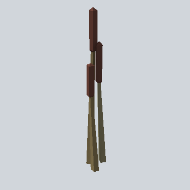

# EA03_Nature_SweetFlag_02c_PRE

Generated by `tools/assets/gen_prefab_tables.py`: edit only below the Notes heading.

| Field | Value |
| --- | --- |
| Pack | EmaceArt-SlavicWorldFree |
| Path | `Prefabs/Nature/Plant/EA03_Nature_SweetFlag_02c_PRE.prefab` |
| GUID | `43d41ea3a8e1b1846b19290321105450` |
| Subgroup | Plant |
| Size (m) | 3.0 |
| Collider | none |
| LODs | 3 |
| Meshes | `EA03_Nature_SweetFlag_02c.fbx` |
| Materials | `EA03_LPNP-Slavika_Colorsheet_v1.mat` |
| Nested prefabs | none |
| In demo scene | 0 |
| Bounds W x H x D (m) | 0.47 x 2.95 x 0.32 |
| Footprint (m) | 0.5 x 0.3 |
| Pivot | bottom at y = -0.01; center offset x -0.29, z 0.17 |
| Triangles / vertices (LOD0) | 102 / 204 |
| Average color | `#4E3F2F` |
| Dominant colors | `#4E4834` 36%, `#3A2520` 19%, `#54342C` 13% |

Colors are read from the rendered preview, so they include lighting. Bounds cover LOD0 renderers.

## Notes

TODO: hand-written usage notes.
