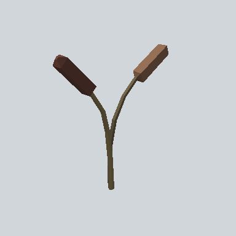

# EA03_Nature_SweetFlag_02d_PRE

Generated by `tools/assets/gen_prefab_tables.py`: edit only below the Notes heading.

| Field | Value |
| --- | --- |
| Pack | EmaceArt-SlavicWorldFree |
| Path | `Prefabs/Nature/Plant/EA03_Nature_SweetFlag_02d_PRE.prefab` |
| GUID | `0530071620d01e84a8190c1933d35baf` |
| Subgroup | Plant |
| Size (m) | 2.3 |
| Collider | none |
| LODs | 3 |
| Meshes | `EA03_Nature_SweetFlag_02d.fbx` |
| Materials | `EA03_LPNP-Slavika_Colorsheet_v1.mat` |
| Nested prefabs | none |
| In demo scene | 0 |
| Bounds W x H x D (m) | 2.15 x 2.32 x 0.21 |
| Footprint (m) | 2.1 x 0.2 |
| Pivot | bottom at y = -0.00; center offset x -0.25, z -0.01 |
| Triangles / vertices (LOD0) | 116 / 224 |
| Average color | `#523E30` |
| Dominant colors | `#3B2821` 29%, `#504631` 23%, `#4A362A` 21% |

Colors are read from the rendered preview, so they include lighting. Bounds cover LOD0 renderers.

## Notes

TODO: hand-written usage notes.
