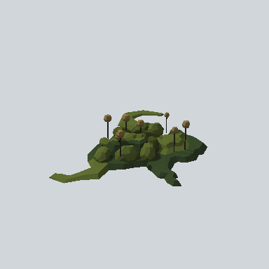

# EA03_Nature_TrunkPlant_01a_PRE

Generated by `tools/assets/gen_prefab_tables.py`: edit only below the Notes heading.

| Field | Value |
| --- | --- |
| Pack | EmaceArt-SlavicWorldFree |
| Path | `Prefabs/Nature/Plant/EA03_Nature_TrunkPlant_01a_PRE.prefab` |
| GUID | `72a8c53098f2bc94380086efa611037d` |
| Subgroup | Plant |
| Size (m) | 4.4 |
| Collider | none |
| LODs | 3 |
| Meshes | `EA03_Nature_TrunkPlant_01a.fbx` |
| Materials | `EA03_LPNP-Slavika_Colorsheet_v1.mat` |
| Nested prefabs | none |
| In demo scene | 0 |
| Bounds W x H x D (m) | 4.41 x 0.89 x 3.67 |
| Footprint (m) | 4.4 x 3.7 |
| Pivot | bottom at y = -0.01; center offset x 0.25, z -0.13 |
| Triangles / vertices (LOD0) | 2,310 / 5,396 |
| Average color | `#404A25` |
| Dominant colors | `#29311B` 24%, `#374728` 20%, `#4C5427` 17% |

Colors are read from the rendered preview, so they include lighting. Bounds cover LOD0 renderers.

## Notes

TODO: hand-written usage notes.
