# Nature

**Prefabs: 34**

Vegetation: trees, bushes, plants, grass. Every prefab has its own card; see [Prefabs](#prefabs).

| Subgroup | Count | Size (m) | Collider | What it is |
| --- | --- | --- | --- | --- |
| `Tree` | 7 | 9.3 - 16.8 | 6 Mesh, 1 Box | four tree shapes, below |
| `Bushes` | 14 | 0.5 - 5.9 tall | mostly none | round olive bushes, tall hedge columns, flat ground mats |
| `Plant` | 9 | 0.9 - 3.4 tall | none | `SweetFlag_*`: bare 3 m stalks with drooping grey strands, like dead saplings; `TrunkPlant_01a`: a 4.4 x 3.7 m low leafy mound with seed-head flowers |
| `Grass` | 4 | 0.5 - 0.8 tall | none | grass tufts |

Trees, as they look in the previews (all dark olive foliage, `#272D18` - `#4C5626`):

| Shape | Prefabs | W x H (m) | Fits |
| --- | --- | --- | --- |
| slim, poplar-like: thin trunk, a few tall leaf clumps | `Tree_01b`, `Tree_02b`, `Tree_02c` | 3.3 - 4.7 x 9.4 - 11.5 | forest, roadsides; `01b` is the demo's only forest tree |
| weeping willow: grey trunk, hanging strands | `Tree_03b`, `Tree_03c` | 4.9 - 7.5 x 9.3 - 11.8 | river banks, swamp; `03c` is 10 k triangles |
| gnarled and sparse: twisted dark trunk, few leaves | `Tree_05a` | 6.7 x 11.8 | dark or dead zones |
| column topiary: one tall clipped block | `Tree_06b` | 6.3 x 16.8 | landmark, village or formal edge |

Bushes: `Bush_01a..d`, `02a/b` are 2 - 2.6 m wide, 3.6 - 4.0 m tall clusters;
`03a..c` are low 1.4 - 1.7 m mounds; `04a` is brownish; `05a/b` are 5.9 m tall
hedge columns; `Bush_03d` and `Bush_Flat_03d` are flat 4 - 5 m ground mats.

## Using it in a map

- This is the strongest category for forest, meadow and swamp regions.
- The demo scene is 10,733 grass instances and 108 trees (almost all
  `Nature_Tree_01b`). Grass at that count only works as terrain detail or GPU
  instancing, not as game objects.
- Bushes and plants have no collider, so they never block movement. Trees do.
- A biome needs more than one tree shape to look natural: mix the slim trees
  with round bushes for forest, willows with the bare `SweetFlag` stalks for wet
  or dead ground.

## Gaps

- No conifers, palms, autumn or flowering variants; every tree is olive green.

## Prefabs

<!-- PREFAB-INDEX:START (generated) -->

**34 prefabs**, one card each.

| Preview | Subgroup | Prefab | W x H x D (m) | Main color | In scene |
| --- | --- | --- | --- | --- | --- |
| 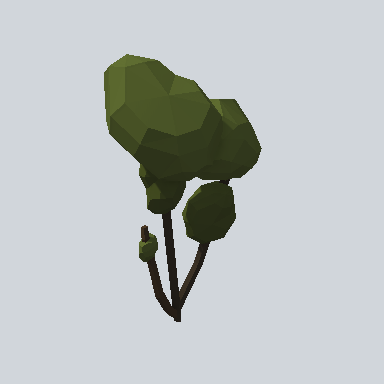 | Bushes | [EA03_Nature_Bush_01a_PRE](Bushes/EA03_Nature_Bush_01a_PRE.md) | 2.3 x 3.6 x 1.4 | `#2C3219` | - |
|  | Bushes | [EA03_Nature_Bush_01b_PRE](Bushes/EA03_Nature_Bush_01b_PRE.md) | 2.0 x 4.0 x 2.8 | `#2B3018` | - |
| 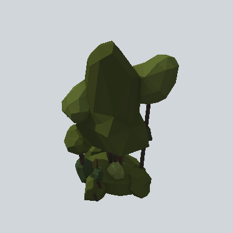 | Bushes | [EA03_Nature_Bush_01c_PRE](Bushes/EA03_Nature_Bush_01c_PRE.md) | 2.6 x 4.0 x 2.5 | `#292E17` | - |
| 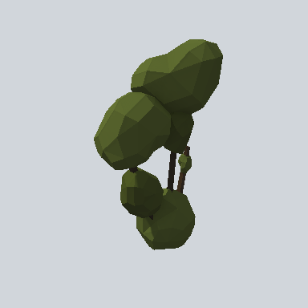 | Bushes | [EA03_Nature_Bush_01d_PRE](Bushes/EA03_Nature_Bush_01d_PRE.md) | 2.3 x 3.6 x 1.4 | `#2E341A` | - |
|  | Bushes | [EA03_Nature_Bush_02a_PRE](Bushes/EA03_Nature_Bush_02a_PRE.md) | 2.2 x 3.7 x 2.6 | `#272C16` | - |
| 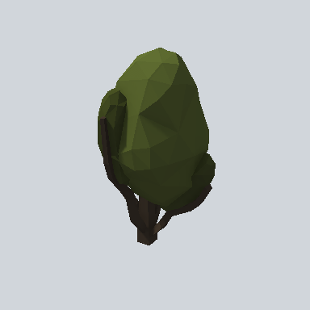 | Bushes | [EA03_Nature_Bush_02b_PRE](Bushes/EA03_Nature_Bush_02b_PRE.md) | 2.1 x 3.7 x 2.3 | `#2C3219` | - |
|  | Bushes | [EA03_Nature_Bush_03a_PRE](Bushes/EA03_Nature_Bush_03a_PRE.md) | 2.7 x 1.7 x 2.7 | `#2E3319` | - |
| 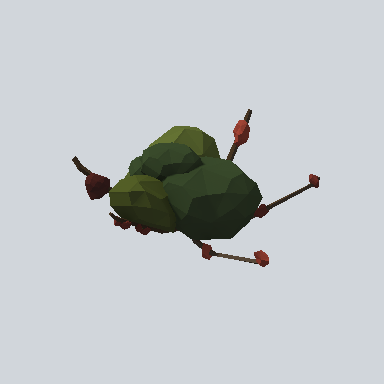 | Bushes | [EA03_Nature_Bush_03b_PRE](Bushes/EA03_Nature_Bush_03b_PRE.md) | 2.6 x 1.6 x 3.4 | `#272D19` | - |
|  | Bushes | [EA03_Nature_Bush_03c_PRE](Bushes/EA03_Nature_Bush_03c_PRE.md) | 1.9 x 1.4 x 1.8 | `#2D3419` | - |
|  | Bushes | [EA03_Nature_Bush_03d_PRE](Bushes/EA03_Nature_Bush_03d_PRE.md) | 4.4 x 0.5 x 3.3 | `#475126` | - |
| 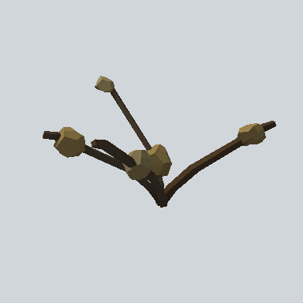 | Bushes | [EA03_Nature_Bush_04a_PRE](Bushes/EA03_Nature_Bush_04a_PRE.md) | 2.5 x 1.5 x 2.2 | `#4F442B` | - |
| 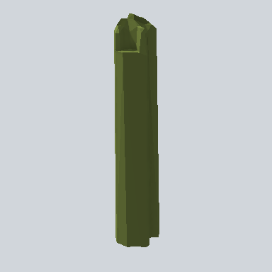 | Bushes | [EA03_Nature_Bush_05a_PRE](Bushes/EA03_Nature_Bush_05a_PRE.md) | 1.2 x 5.9 x 1.1 | `#404924` | - |
|  | Bushes | [EA03_Nature_Bush_05b_PRE](Bushes/EA03_Nature_Bush_05b_PRE.md) | 2.1 x 5.9 x 2.0 | `#414A25` | - |
|  | Bushes | [EA03_Nature_Bush_Flat_03d_PRE](Bushes/EA03_Nature_Bush_Flat_03d_PRE.md) | 5.1 x 0.4 x 4.7 | `#758344` | - |
| 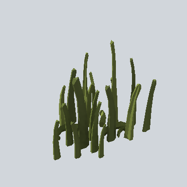 | Grass | [EA03_Plant_Grass_01c_PRE](Grass/EA03_Plant_Grass_01c_PRE.md) | 0.9 x 0.7 x 0.6 | `#31381C` | - |
| 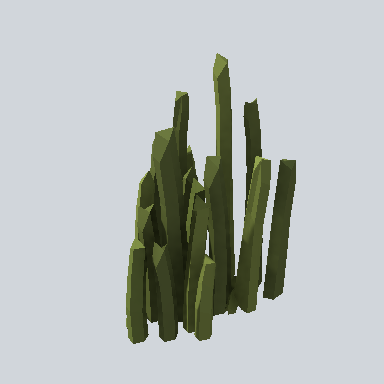 | Grass | [EA03_Plant_Grass_01d_PRE](Grass/EA03_Plant_Grass_01d_PRE.md) | 0.6 x 0.8 x 0.4 | `#2E3319` | - |
|  | Grass | [EA03_Plant_Grass_01e_PRE](Grass/EA03_Plant_Grass_01e_PRE.md) | 1.7 x 0.7 x 1.3 | `#474F27` | 344 |
| 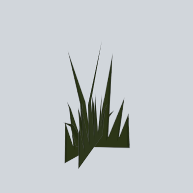 | Grass | [EA03_Plant_Grass_02a_PRE](Grass/EA03_Plant_Grass_02a_PRE.md) | 0.4 x 0.5 x 0.3 | `#2A3318` | 10389 |
|  | Plant | [EA03_Nature_SweetFlag_01a_PRE](Plant/EA03_Nature_SweetFlag_01a_PRE.md) | 0.2 x 3.0 x 0.2 | `#1B1916` | - |
| 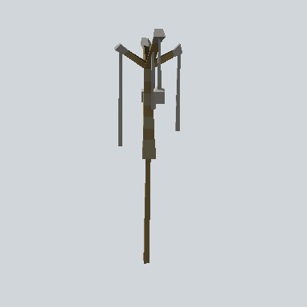 | Plant | [EA03_Nature_SweetFlag_01b_PRE](Plant/EA03_Nature_SweetFlag_01b_PRE.md) | 0.8 x 3.4 x 0.9 | `#4D442E` | - |
| 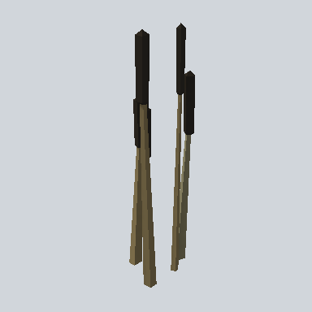 | Plant | [EA03_Nature_SweetFlag_01c_PRE](Plant/EA03_Nature_SweetFlag_01c_PRE.md) | 0.9 x 3.0 x 0.6 | `#4D4531` | - |
| 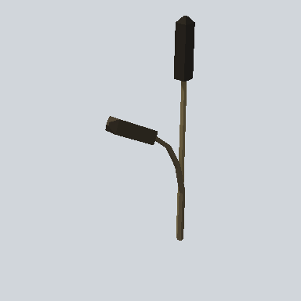 | Plant | [EA03_Nature_SweetFlag_01d_PRE](Plant/EA03_Nature_SweetFlag_01d_PRE.md) | 1.3 x 3.0 x 0.2 | `#26221B` | - |
|  | Plant | [EA03_Nature_SweetFlag_01e_PRE](Plant/EA03_Nature_SweetFlag_01e_PRE.md) | 0.8 x 2.8 x 0.6 | `#565550` | - |
|  | Plant | [EA03_Nature_SweetFlag_02a_PRE](Plant/EA03_Nature_SweetFlag_02a_PRE.md) | 0.2 x 3.0 x 0.2 | `#4F3728` | - |
|  | Plant | [EA03_Nature_SweetFlag_02c_PRE](Plant/EA03_Nature_SweetFlag_02c_PRE.md) | 0.5 x 3.0 x 0.3 | `#4E4834` | - |
|  | Plant | [EA03_Nature_SweetFlag_02d_PRE](Plant/EA03_Nature_SweetFlag_02d_PRE.md) | 2.1 x 2.3 x 0.2 | `#3B2821` | - |
|  | Plant | [EA03_Nature_TrunkPlant_01a_PRE](Plant/EA03_Nature_TrunkPlant_01a_PRE.md) | 4.4 x 0.9 x 3.7 | `#29311B` | - |
|  | Tree | [EA03_Nature_Tree_01b_PRE](Tree/EA03_Nature_Tree_01b_PRE.md) | 3.3 x 10.3 x 3.3 | `#272D18` | 107 |
|  | Tree | [EA03_Nature_Tree_02b_PRE](Tree/EA03_Nature_Tree_02b_PRE.md) | 4.7 x 11.5 x 2.9 | `#2B3118` | - |
| 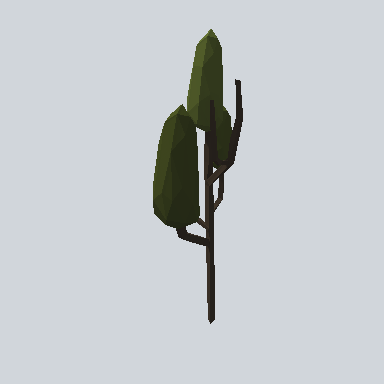 | Tree | [EA03_Nature_Tree_02c_PRE](Tree/EA03_Nature_Tree_02c_PRE.md) | 3.4 x 9.4 x 2.4 | `#292C18` | - |
| 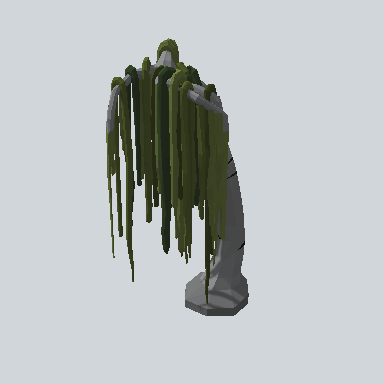 | Tree | [EA03_Nature_Tree_03b_PRE](Tree/EA03_Nature_Tree_03b_PRE.md) | 4.9 x 9.3 x 4.8 | `#2C3219` | 1 |
|  | Tree | [EA03_Nature_Tree_03c_PRE](Tree/EA03_Nature_Tree_03c_PRE.md) | 7.5 x 11.8 x 5.0 | `#282D17` | - |
| 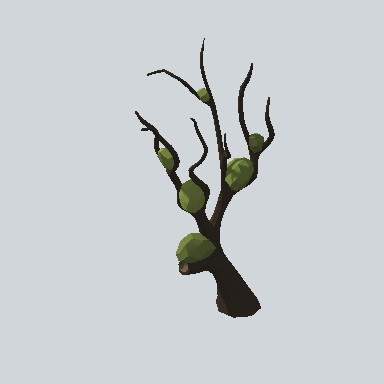 | Tree | [EA03_Nature_Tree_05a_PRE](Tree/EA03_Nature_Tree_05a_PRE.md) | 6.7 x 11.8 x 4.5 | `#211D18` | - |
|  | Tree | [EA03_Nature_Tree_06b_PRE](Tree/EA03_Nature_Tree_06b_PRE.md) | 6.3 x 16.8 x 5.7 | `#2F351B` | - |

<!-- PREFAB-INDEX:END -->
