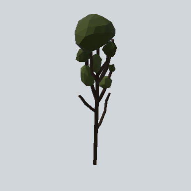

# EA03_Nature_Tree_01b_PRE

Generated by `tools/assets/gen_prefab_tables.py`: edit only below the Notes heading.

| Field | Value |
| --- | --- |
| Pack | EmaceArt-SlavicWorldFree |
| Path | `Prefabs/Nature/Tree/EA03_Nature_Tree_01b_PRE.prefab` |
| GUID | `e03898b14a86f234a97b28e18ce3a154` |
| Subgroup | Tree |
| Size (m) | 10.3 |
| Collider | Mesh |
| LODs | 3 |
| Meshes | `EA03_Nature_Tree_01b.fbx` |
| Materials | `EA03_LPNP-Slavika_Colorsheet_wind_tree.mat` |
| Nested prefabs | none |
| In demo scene | 107 |
| Bounds W x H x D (m) | 3.27 x 10.29 x 3.25 |
| Footprint (m) | 3.3 x 3.3 |
| Pivot | bottom at y = -0.00; center offset x 0.01, z -0.13 |
| Triangles / vertices (LOD0) | 595 / 1,416 |
| Average color | `#282B19` |
| Dominant colors | `#272D18` 26%, `#1A1510` 24%, `#1D220F` 19% |

Colors are read from the rendered preview, so they include lighting. Bounds cover LOD0 renderers.

## Notes

TODO: hand-written usage notes.
