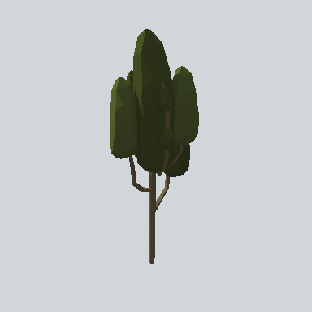

# EA03_Nature_Tree_02b_PRE

Generated by `tools/assets/gen_prefab_tables.py`: edit only below the Notes heading.

| Field | Value |
| --- | --- |
| Pack | EmaceArt-SlavicWorldFree |
| Path | `Prefabs/Nature/Tree/EA03_Nature_Tree_02b_PRE.prefab` |
| GUID | `1286e3a745458f4438fb05c8ad88add5` |
| Subgroup | Tree |
| Size (m) | 11.5 |
| Collider | Mesh |
| LODs | 3 |
| Meshes | `EA03_Nature_Tree_02b.fbx` |
| Materials | `EA03_LPNP-Slavika_Colorsheet_v1.mat` |
| Nested prefabs | none |
| In demo scene | 0 |
| Bounds W x H x D (m) | 4.65 x 11.54 x 2.91 |
| Footprint (m) | 4.7 x 2.9 |
| Pivot | bottom at y = -0.00; center offset x -0.05, z 0.31 |
| Triangles / vertices (LOD0) | 792 / 1,928 |
| Average color | `#31361C` |
| Dominant colors | `#2B3118` 77%, `#3C3427` 7%, `#4C5626` 5% |

Colors are read from the rendered preview, so they include lighting. Bounds cover LOD0 renderers.

## Notes

TODO: hand-written usage notes.
