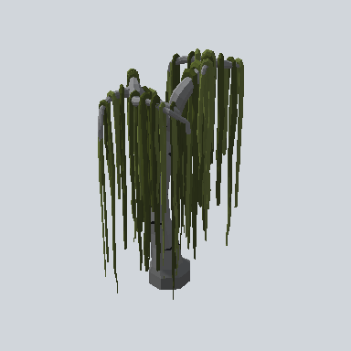

# EA03_Nature_Tree_03c_PRE

Generated by `tools/assets/gen_prefab_tables.py`: edit only below the Notes heading.

| Field | Value |
| --- | --- |
| Pack | EmaceArt-SlavicWorldFree |
| Path | `Prefabs/Nature/Tree/EA03_Nature_Tree_03c_PRE.prefab` |
| GUID | `f1b66556485f0e542b87652d7fbe5423` |
| Subgroup | Tree |
| Size (m) | 11.8 |
| Collider | Mesh |
| LODs | 3 |
| Meshes | `EA03_Nature_Tree_03c.fbx` |
| Materials | `EA03_LPNP-Slavika_Colorsheet_v1.mat` |
| Nested prefabs | none |
| In demo scene | 0 |
| Bounds W x H x D (m) | 7.49 x 11.80 x 5.03 |
| Footprint (m) | 7.5 x 5.0 |
| Pivot | bottom at y = 0.04; center offset x 0.08, z 0.56 |
| Triangles / vertices (LOD0) | 10,046 / 21,189 |
| Average color | `#383D26` |
| Dominant colors | `#282D17` 45%, `#3A4123` 23%, `#494A4B` 11% |

Colors are read from the rendered preview, so they include lighting. Bounds cover LOD0 renderers.

## Notes

TODO: hand-written usage notes.
