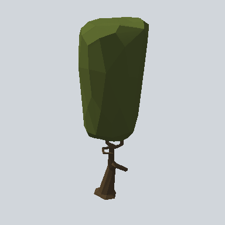

# EA03_Nature_Tree_06b_PRE

Generated by `tools/assets/gen_prefab_tables.py`: edit only below the Notes heading.

| Field | Value |
| --- | --- |
| Pack | EmaceArt-SlavicWorldFree |
| Path | `Prefabs/Nature/Tree/EA03_Nature_Tree_06b_PRE.prefab` |
| GUID | `2ed5b1506cf0a264683623f6ebafa66d` |
| Subgroup | Tree |
| Size (m) | 16.8 |
| Collider | Box |
| LODs | 3 |
| Meshes | `EA03_Nature_Tree_06b.fbx` |
| Materials | `EA03_LPNP-Slavika_Colorsheet_v1.mat` |
| Nested prefabs | none |
| In demo scene | 0 |
| Bounds W x H x D (m) | 6.31 x 16.81 x 5.72 |
| Footprint (m) | 6.3 x 5.7 |
| Pivot | bottom at y = 0.00; center offset x -0.04, z -0.11 |
| Triangles / vertices (LOD0) | 408 / 845 |
| Average color | `#3A401F` |
| Dominant colors | `#2F351B` 62%, `#3C4520` 12%, `#495026` 11% |

Colors are read from the rendered preview, so they include lighting. Bounds cover LOD0 renderers.

## Notes

TODO: hand-written usage notes.
