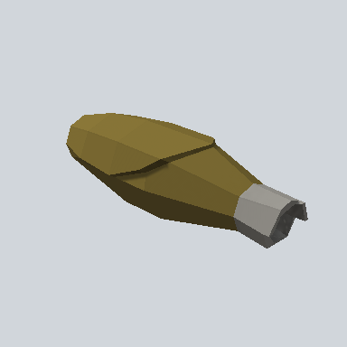

# EA03_Items_House_Corn_01a_PRE

Generated by `tools/assets/gen_prefab_tables.py`: edit only below the Notes heading.

| Field | Value |
| --- | --- |
| Pack | EmaceArt-SlavicWorldFree |
| Path | `Prefabs/Prop/EA03_Items_House_Corn_01a_PRE.prefab` |
| GUID | `a0d15454e8d6fe747b16d15d27d52814` |
| Subgroup | - |
| Size (m) | 0.3 |
| Collider | Mesh |
| LODs | 3 |
| Meshes | `EA03_Items_House_Corn_01a.fbx` |
| Materials | `EA03_LPNP-Slavika_Colorsheet_v1.mat` |
| Nested prefabs | none |
| In demo scene | 0 |
| Bounds W x H x D (m) | 0.11 x 0.10 x 0.32 |
| Footprint (m) | 0.1 x 0.3 |
| Pivot | bottom at y = 0.00; center offset x 0.00, z 0.00 |
| Triangles / vertices (LOD0) | 151 / 303 |
| Average color | `#6A5E36` |
| Dominant colors | `#766630` 27%, `#857336` 18%, `#3B321A` 17% |

Colors are read from the rendered preview, so they include lighting. Bounds cover LOD0 renderers.

## Notes

TODO: hand-written usage notes.
