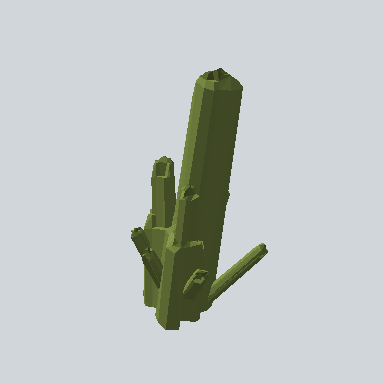

# EA_Artefact_PRE

Generated by `tools/assets/gen_prefab_tables.py`: edit only below the Notes heading.

| Field | Value |
| --- | --- |
| Pack | EmaceArt-SlavicWorldFree |
| Path | `Prefabs/Prop/EA_Artefact_PRE.prefab` |
| GUID | `d93158440308f6a4f88ef35c5fdeb20f` |
| Subgroup | - |
| Size (m) | unknown (no LOD group) |
| Collider | Mesh |
| LODs | none |
| Meshes | `EA03_Nature_Bush_05a.fbx` |
| Materials | `Art_01.mat`, `Art_02.mat`, `Art_03.mat`, `Water.mat` |
| Nested prefabs | `EA03_Nature_Bush_05a_PRE`, `EA03_Nature_Bush_05b_PRE` |
| In demo scene | 0 |
| Bounds W x H x D (m) | 14.71 x 26.40 x 15.96 |
| Footprint (m) | 14.7 x 16.0 |
| Pivot | bottom at y = -0.00; center offset x 0.00, z 0.03 |
| Triangles / vertices (LOD0) | 1,082 / 2,572 |
| Average color | `#4B552A` |
| Dominant colors | `#3E4623` 50%, `#465027` 18%, `#596531` 13% |

Colors are read from the rendered preview, so they include lighting. Bounds cover LOD0 renderers.

## Notes

TODO: hand-written usage notes.
