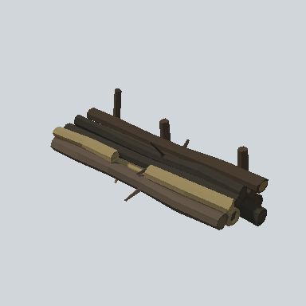

# EA03_Prop_Forester_CutOutTrees_03_PRE

Generated by `tools/assets/gen_prefab_tables.py`: edit only below the Notes heading.

| Field | Value |
| --- | --- |
| Pack | EmaceArt-SlavicWorldFree |
| Path | `Prefabs/Prop/Forester/EA03_Prop_Forester_CutOutTrees_03_PRE.prefab` |
| GUID | `d437dde4e0c296c47bc302794fc84bbc` |
| Subgroup | Forester |
| Size (m) | 17.3 |
| Collider | Mesh |
| LODs | 3 |
| Meshes | `EA03_Prop_Forester_CutOutTrees_03.fbx` |
| Materials | `EA03_LPNP-Slavika_Colorsheet_v1.mat` |
| Nested prefabs | none |
| In demo scene | 0 |
| Bounds W x H x D (m) | 6.07 x 4.68 x 17.27 |
| Footprint (m) | 6.1 x 17.3 |
| Pivot | bottom at y = 0.00; center offset x 0.16, z 0.45 |
| Triangles / vertices (LOD0) | 1,466 / 2,466 |
| Average color | `#4D4435` |
| Dominant colors | `#37322A` 36%, `#463B2E` 15%, `#99885D` 12% |

Colors are read from the rendered preview, so they include lighting. Bounds cover LOD0 renderers.

## Notes

TODO: hand-written usage notes.
