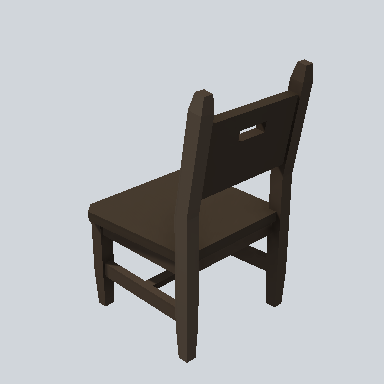

# EA03_Prop_Stool_02a_PRE

Generated by `tools/assets/gen_prefab_tables.py`: edit only below the Notes heading.

| Field | Value |
| --- | --- |
| Pack | EmaceArt-SlavicWorldFree |
| Path | `Prefabs/Prop/Furniture/EA03_Prop_Stool_02a_PRE.prefab` |
| GUID | `735b2aa9d4617d84986ed8f20691ced9` |
| Subgroup | Furniture |
| Size (m) | 1.1 |
| Collider | Box |
| LODs | 3 |
| Meshes | `EA03_Prop_Stool_02a.fbx` |
| Materials | `EA03_LPNP-Slavika_Colorsheet_v1.mat` |
| Nested prefabs | none |
| In demo scene | 2 |
| Bounds W x H x D (m) | 0.60 x 1.08 x 0.68 |
| Footprint (m) | 0.6 x 0.7 |
| Pivot | bottom at y = 0.00; center offset x -0.00, z -0.00 |
| Triangles / vertices (LOD0) | 204 / 348 |
| Average color | `#342C24` |
| Dominant colors | `#453A2F` 35%, `#352D25` 23%, `#221E19` 23% |

Colors are read from the rendered preview, so they include lighting. Bounds cover LOD0 renderers.

## Notes

TODO: hand-written usage notes.
