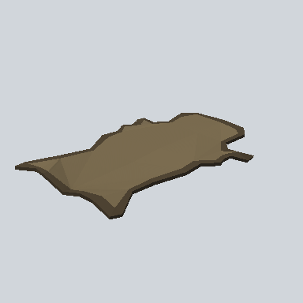

# EA03_Prop_Town_AnimalSkin_01b_PRE

Generated by `tools/assets/gen_prefab_tables.py`: edit only below the Notes heading.

| Field | Value |
| --- | --- |
| Pack | EmaceArt-SlavicWorldFree |
| Path | `Prefabs/Prop/Hunter/EA03_Prop_Town_AnimalSkin_01b_PRE.prefab` |
| GUID | `ac36a83878e33e54cb3ec90ee13a76db` |
| Subgroup | Hunter |
| Size (m) | 1.5 |
| Collider | none |
| LODs | 3 |
| Meshes | `EA03_Prop_Town_AnimalSkin_01b.fbx` |
| Materials | `EA03_LPNP-Slavika_Colorsheet_v1.mat` |
| Nested prefabs | none |
| In demo scene | 1 |
| Bounds W x H x D (m) | 1.51 x 0.09 x 1.04 |
| Footprint (m) | 1.5 x 1.0 |
| Pivot | bottom at y = -0.01; center offset x 0.01, z 0.01 |
| Triangles / vertices (LOD0) | 276 / 570 |
| Average color | `#6A5D45` |
| Dominant colors | `#786A4E` 72%, `#4E4332` 17%, `#26221B` 4% |

Colors are read from the rendered preview, so they include lighting. Bounds cover LOD0 renderers.

## Notes

TODO: hand-written usage notes.
