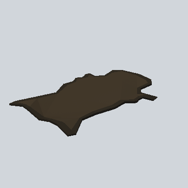

# EA03_Prop_Town_AnimalSkin_01c_PRE

Generated by `tools/assets/gen_prefab_tables.py`: edit only below the Notes heading.

| Field | Value |
| --- | --- |
| Pack | EmaceArt-SlavicWorldFree |
| Path | `Prefabs/Prop/Hunter/EA03_Prop_Town_AnimalSkin_01c_PRE.prefab` |
| GUID | `08441e675aa177c45a27d34fb11c3114` |
| Subgroup | Hunter |
| Size (m) | 1.5 |
| Collider | none |
| LODs | 3 |
| Meshes | `EA03_Prop_Town_AnimalSkin_01c.fbx` |
| Materials | `EA03_LPNP-Slavika_Colorsheet_v1.mat` |
| Nested prefabs | none |
| In demo scene | 1 |
| Bounds W x H x D (m) | 1.51 x 0.08 x 1.04 |
| Footprint (m) | 1.5 x 1.0 |
| Pivot | bottom at y = -0.03; center offset x 0.01, z 0.01 |
| Triangles / vertices (LOD0) | 276 / 542 |
| Average color | `#3A3226` |
| Dominant colors | `#403629` 59%, `#352E24` 33%, `#191815` 4% |

Colors are read from the rendered preview, so they include lighting. Bounds cover LOD0 renderers.

## Notes

TODO: hand-written usage notes.
