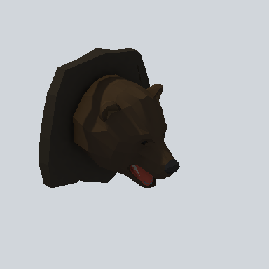

# EA_Prop_Hunter_Animal_Trophy_01a_PRE

Generated by `tools/assets/gen_prefab_tables.py`: edit only below the Notes heading.

| Field | Value |
| --- | --- |
| Pack | EmaceArt-SlavicWorldFree |
| Path | `Prefabs/Prop/Hunter/EA_Prop_Hunter_Animal_Trophy_01a_PRE.prefab` |
| GUID | `42401a433a5c1874f8f51bdcd68b2e30` |
| Subgroup | Hunter |
| Size (m) | 1.3 |
| Collider | Mesh |
| LODs | 3 |
| Meshes | `EA_Prop_Hunter_Animal_Trophy_01a.fbx` |
| Materials | `EA03_LPNP-Slavika_Colorsheet_v1.mat` |
| Nested prefabs | none |
| In demo scene | 0 |
| Bounds W x H x D (m) | 1.26 x 1.23 x 0.87 |
| Footprint (m) | 1.3 x 0.9 |
| Pivot | bottom at y = -0.74; center offset x 0.00, z 0.43 |
| Triangles / vertices (LOD0) | 745 / 1,416 |
| Average color | `#211B16` |
| Dominant colors | `#181613` 47%, `#221B15` 26%, `#2F251A` 22% |

Colors are read from the rendered preview, so they include lighting. Bounds cover LOD0 renderers.

## Notes

TODO: hand-written usage notes.
