# Prop

**Prefabs: 54**

Standalone objects for scatter and interiors: containers, furniture, tools. Every prefab has its own card; see [Prefabs](#prefabs).

| Subgroup | Count | Size (m) | What it is |
| --- | --- | --- | --- |
| `Container` | 14 | 0.3 - 1.7 | bags, bales, barrels, baskets, crates, chests; the most used in the scene (46) |
| `Furniture` | 14 | 0.5 - 3.7 | shelves, stools, tables, bench, bed; mostly Box colliders |
| `wooden` | 5 | 0.8 - 2.3 | wood pieces, pins, a withy fence |
| `Village` | 4 | 2.0 - 5.6 | stove, stand, ladder, wheel |
| `Carpentry` | 3 | 1.2 - 1.7 | brushwood, stump, desk set |
| `Hunter` | 3 | 1.3 - 1.5 | animal skins and a trophy |
| `Forester` | 2 | 2.2 - 17.3 | cut-out trees (17.3 m) and a wooden piece |
| `Sign` | 1 | 4.0 | chapel sign |
| (root) | 8 | 0.2 - 0.3 | food items such as apples and carrots |

## Using it in a map

- Container and Carpentry props are the outdoor scatter set for a village
  region: bales, baskets, brushwood near huts.
- Furniture, Hunter and the root food items are interior dressing and belong
  with `Rooms` and `Items`, not in open ground scatter.
- `Forester/..CutOutTrees` is 17.3 m, much larger than other props; treat it as
  a landmark, not scatter.

## Gaps

- No wilderness props (campfire, tent, signpost besides the chapel sign).

## Prefabs

<!-- PREFAB-INDEX:START (generated) -->

**54 prefabs**, one card each.

| Preview | Subgroup | Prefab | W x H x D (m) | Main color | In scene |
| --- | --- | --- | --- | --- | --- |
| 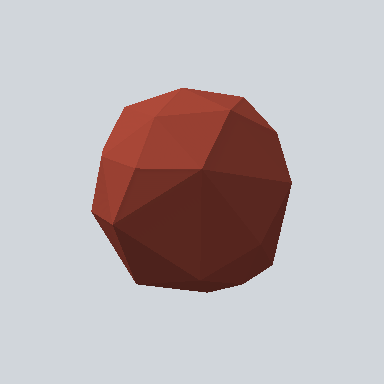 | - | [EA03_Items_House_Apple_01a__PRE](EA03_Items_House_Apple_01a__PRE.md) | 0.2 x 0.2 x 0.2 | `#54241D` | - |
| 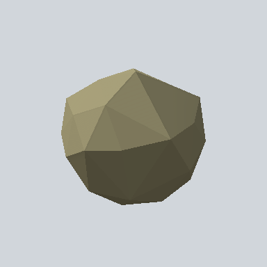 | - | [EA03_Items_House_Apple_01b__PRE](EA03_Items_House_Apple_01b__PRE.md) | 0.2 x 0.2 x 0.2 | `#4E4A38` | - |
| 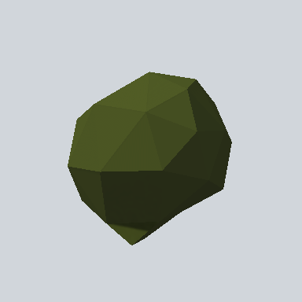 | - | [EA03_Items_House_Apple_01c_PRE](EA03_Items_House_Apple_01c_PRE.md) | 0.2 x 0.2 x 0.2 | `#282D17` | - |
| 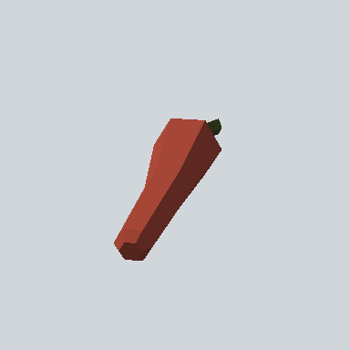 | - | [EA03_Items_House_Carrot_01a__PRE](EA03_Items_House_Carrot_01a__PRE.md) | 0.3 x 0.1 x 0.2 | `#A64636` | - |
|  | - | [EA03_Items_House_Corn_01a_PRE](EA03_Items_House_Corn_01a_PRE.md) | 0.1 x 0.1 x 0.3 | `#766630` | - |
| 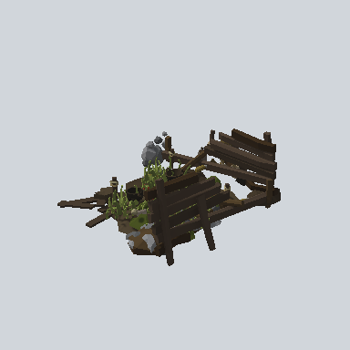 | - | [EA03_Prop_Composter_01a](EA03_Prop_Composter_01a.md) | 7.2 x 3.4 x 6.6 | `#2A241C` | - |
| 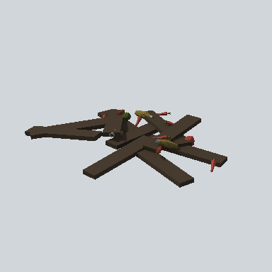 | - | [EA03_Prop_Composter_02a](EA03_Prop_Composter_02a.md) | 2.3 x 0.4 x 3.1 | `#463A2E` | - |
|  | - | [EA_Artefact_PRE](EA_Artefact_PRE.md) | 14.7 x 26.4 x 16.0 | `#3E4623` | - |
| 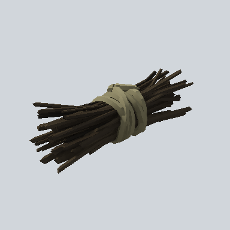 | Carpentry | [EA03_Prop_Brushwood_03a_PRE](Carpentry/EA03_Prop_Brushwood_03a_PRE.md) | 1.7 x 0.6 x 0.6 | `#181510` | 3 |
| 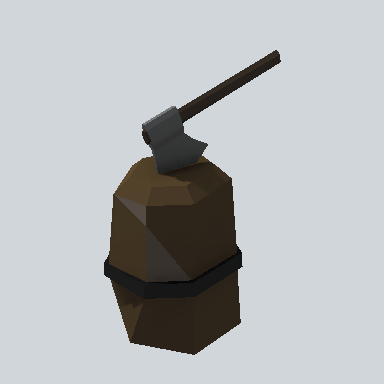 | Carpentry | [EA03_Prop_Tool_Stump_02a_PRE](Carpentry/EA03_Prop_Tool_Stump_02a_PRE.md) | 0.9 x 1.2 x 0.6 | `#2B2319` | 1 |
| 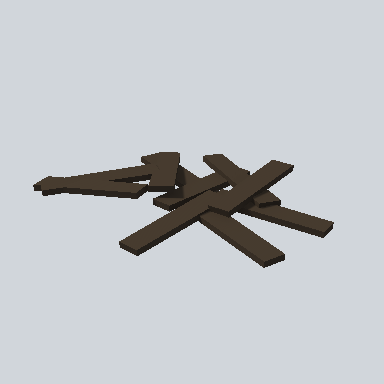 | Carpentry | [EA_Desk_set_01b_PRE](Carpentry/EA_Desk_set_01b_PRE.md) | 3.1 x 0.4 x 3.9 | `#463A2E` | - |
| 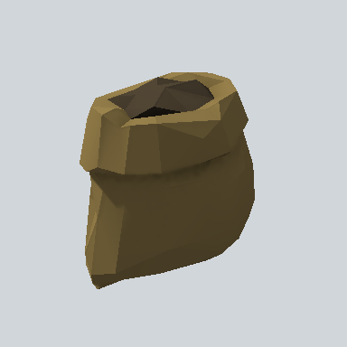 | Container | [EA03_Prop_Container_Bag_02a_PRE](Container/EA03_Prop_Container_Bag_02a_PRE.md) | 0.8 x 0.7 x 0.6 | `#4E4329` | 2 |
| 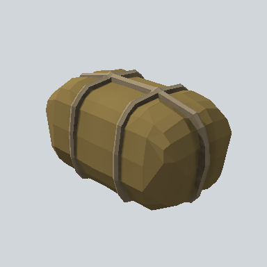 | Container | [EA03_Prop_Container_Bale_01a_PRE](Container/EA03_Prop_Container_Bale_01a_PRE.md) | 0.4 x 0.4 x 0.6 | `#8B7646` | 11 |
| 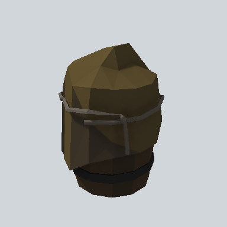 | Container | [EA03_Prop_Container_Barrel_01d_PRE](Container/EA03_Prop_Container_Barrel_01d_PRE.md) | 0.7 x 0.8 x 0.6 | `#2F281A` | 2 |
| 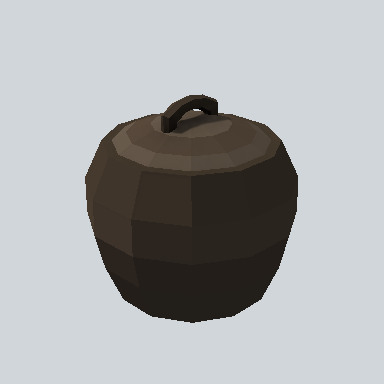 | Container | [EA03_Prop_Container_Basket_01a_PRE](Container/EA03_Prop_Container_Basket_01a_PRE.md) | 0.5 x 0.5 x 0.5 | `#29231D` | 2 |
| 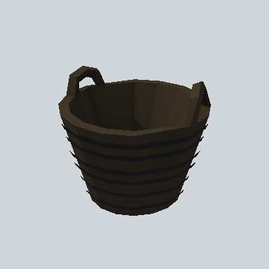 | Container | [EA03_Prop_Container_Basket_02_PRE](Container/EA03_Prop_Container_Basket_02_PRE.md) | 0.6 x 0.5 x 0.6 | `#1A1715` | 3 |
| 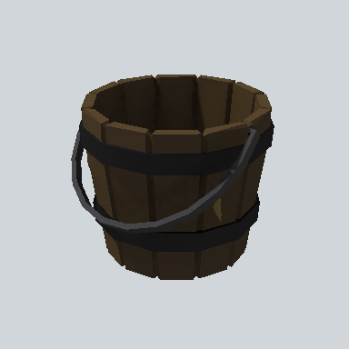 | Container | [EA03_Prop_Container_Basket_03a_PRE](Container/EA03_Prop_Container_Basket_03a_PRE.md) | 0.3 x 0.3 x 0.3 | `#2D2419` | 8 |
| 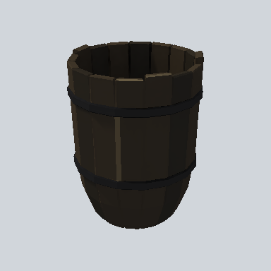 | Container | [EA03_Prop_Container_Basket_04a_PRE](Container/EA03_Prop_Container_Basket_04a_PRE.md) | 0.3 x 0.4 x 0.3 | `#211D18` | 5 |
| 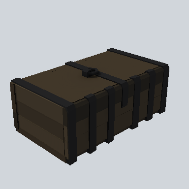 | Container | [EA03_Prop_Container_Chest_02a_PRE](Container/EA03_Prop_Container_Chest_02a_PRE.md) | 1.7 x 0.7 x 1.0 | `#161515` | 1 |
| 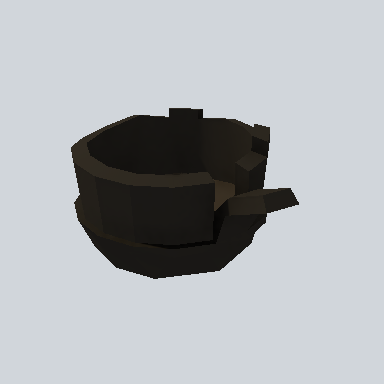 | Container | [EA03_Prop_Container_Conr_01a_PRE](Container/EA03_Prop_Container_Conr_01a_PRE.md) | 0.5 x 0.3 x 0.7 | `#181613` | 2 |
| 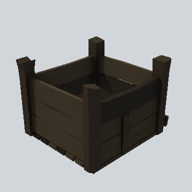 | Container | [EA03_Prop_Container_Crate_01a_PRE](Container/EA03_Prop_Container_Crate_01a_PRE.md) | 0.9 x 0.6 x 0.8 | `#372F24` | 2 |
| 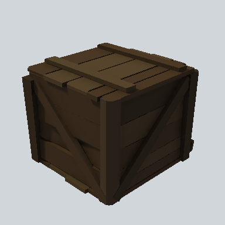 | Container | [EA03_Prop_Container_Crate_02a_PRE](Container/EA03_Prop_Container_Crate_02a_PRE.md) | 1.0 x 0.9 x 1.0 | `#302519` | 2 |
| 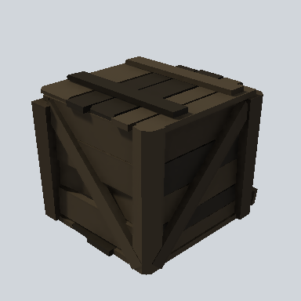 | Container | [EA03_Prop_Container_Crate_03a_PRE](Container/EA03_Prop_Container_Crate_03a_PRE.md) | 0.9 x 0.7 x 0.8 | `#352E23` | 2 |
| 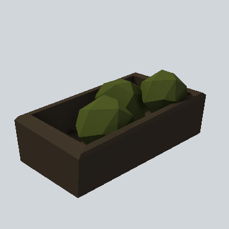 | Container | [EA03_Prop_Vegetable_Bag_02_PRE](Container/EA03_Prop_Vegetable_Bag_02_PRE.md) | 1.0 x 0.4 x 0.6 | `#211C17` | 3 |
| 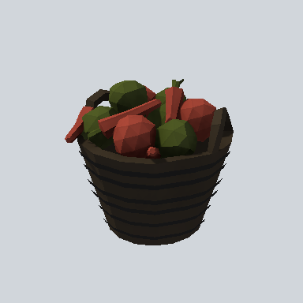 | Container | [EA03_Prop_Vegetable_Basket_01a_PRE](Container/EA03_Prop_Vegetable_Basket_01a_PRE.md) | 0.6 x 0.6 x 0.6 | `#231A16` | 1 |
|  | Forester | [EA03_Prop_Forester_CutOutTrees_03_PRE](Forester/EA03_Prop_Forester_CutOutTrees_03_PRE.md) | 6.1 x 4.7 x 17.3 | `#37322A` | - |
| 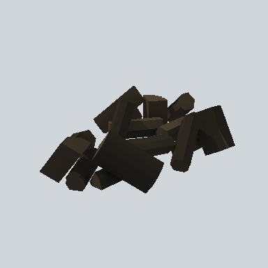 | Forester | [EA03_Prop_Forester_wooden_01d_PRE](Forester/EA03_Prop_Forester_wooden_01d_PRE.md) | 2.2 x 0.6 x 1.6 | `#27221B` | 2 |
| 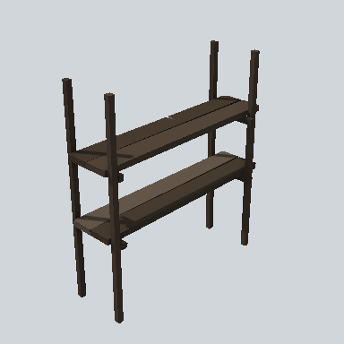 | Furniture | [EA03_Prop_House_Shelf_01a_PRE](Furniture/EA03_Prop_House_Shelf_01a_PRE.md) | 2.3 x 2.4 x 0.7 | `#28221D` | 1 |
| 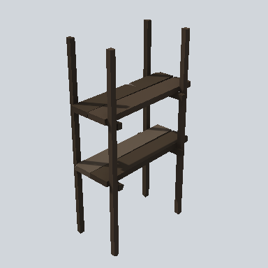 | Furniture | [EA03_Prop_House_Shelf_01c_PRE](Furniture/EA03_Prop_House_Shelf_01c_PRE.md) | 1.4 x 2.4 x 0.7 | `#28221D` | - |
| 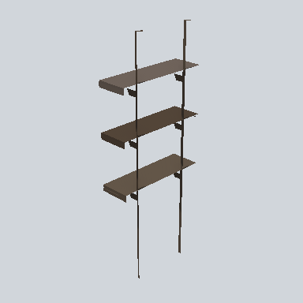 | Furniture | [EA03_Prop_House_Shelf_02c_PRE](Furniture/EA03_Prop_House_Shelf_02c_PRE.md) | 1.5 x 3.7 x 0.5 | `#625547` | - |
| 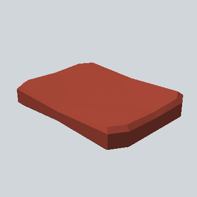 | Furniture | [EA03_Prop_Pillow_01d_PRE](Furniture/EA03_Prop_Pillow_01d_PRE.md) | 0.6 x 0.1 x 0.8 | `#A54636` | 2 |
| 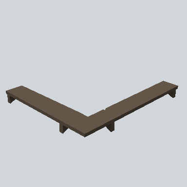 | Furniture | [EA03_Prop_Shelf_01b_PRE](Furniture/EA03_Prop_Shelf_01b_PRE.md) | 2.5 x 0.2 x 2.2 | `#625547` | - |
| 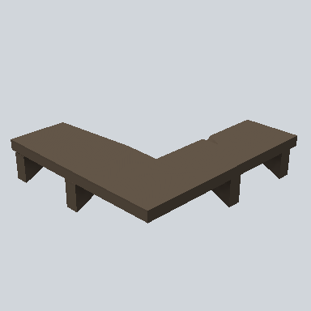 | Furniture | [EA03_Prop_Shelf_01c_PRE](Furniture/EA03_Prop_Shelf_01c_PRE.md) | 1.2 x 0.2 x 1.1 | `#625547` | 1 |
| 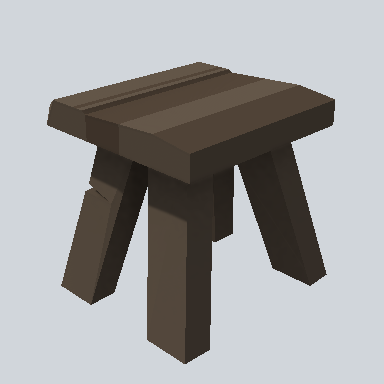 | Furniture | [EA03_Prop_Stool_01a_PRE](Furniture/EA03_Prop_Stool_01a_PRE.md) | 0.5 x 0.5 x 0.5 | `#312B24` | 3 |
|  | Furniture | [EA03_Prop_Stool_02a_PRE](Furniture/EA03_Prop_Stool_02a_PRE.md) | 0.6 x 1.1 x 0.7 | `#453A2F` | 2 |
| 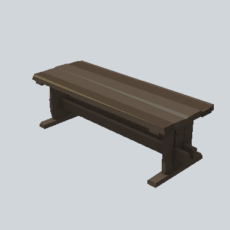 | Furniture | [EA03_Prop_Tabble_01a_PRE](Furniture/EA03_Prop_Tabble_01a_PRE.md) | 1.0 x 0.8 x 2.7 | `#312A24` | 1 |
| 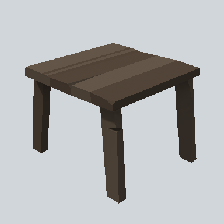 | Furniture | [EA03_Prop_Tabble_02a_PRE](Furniture/EA03_Prop_Tabble_02a_PRE.md) | 0.8 x 0.6 x 0.9 | `#504337` | 1 |
|  | Furniture | [EA03_Prop_Tabble_02a_PRE 1](Furniture/EA03_Prop_Tabble_02a_PRE%201.md) | 2.7 x 1.3 x 1.0 | `#322C26` | - |
| 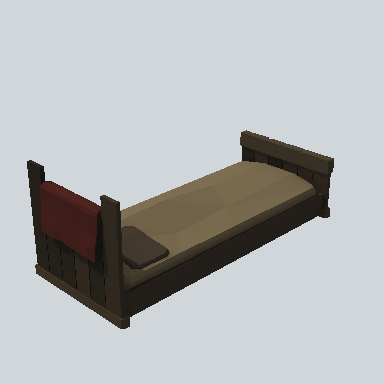 | Furniture | [EA03_Prop_Town_Bed_01a.004_PRE](Furniture/EA03_Prop_Town_Bed_01a.004_PRE.md) | 2.8 x 1.1 x 1.2 | `#75674C` | 1 |
| 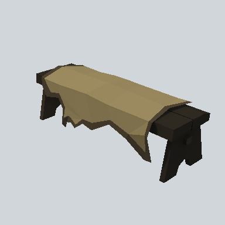 | Furniture | [EA03_Prop_Town_Bench_01a_PRE](Furniture/EA03_Prop_Town_Bench_01a_PRE.md) | 0.5 x 0.4 x 1.4 | `#99885D` | - |
| 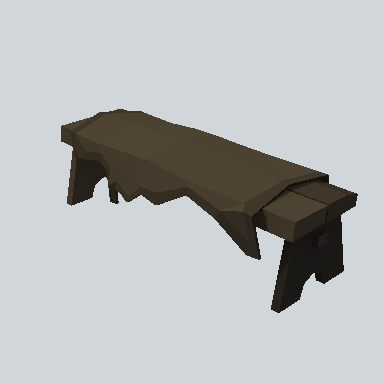 | Furniture | [EA03_Prop_Town_Bench_01b_PRE](Furniture/EA03_Prop_Town_Bench_01b_PRE.md) | 0.5 x 0.4 x 1.4 | `#4E4332` | 2 |
|  | Hunter | [EA03_Prop_Town_AnimalSkin_01b_PRE](Hunter/EA03_Prop_Town_AnimalSkin_01b_PRE.md) | 1.5 x 0.1 x 1.0 | `#786A4E` | 1 |
|  | Hunter | [EA03_Prop_Town_AnimalSkin_01c_PRE](Hunter/EA03_Prop_Town_AnimalSkin_01c_PRE.md) | 1.5 x 0.1 x 1.0 | `#403629` | 1 |
|  | Hunter | [EA_Prop_Hunter_Animal_Trophy_01a_PRE](Hunter/EA_Prop_Hunter_Animal_Trophy_01a_PRE.md) | 1.3 x 1.2 x 0.9 | `#181613` | - |
| 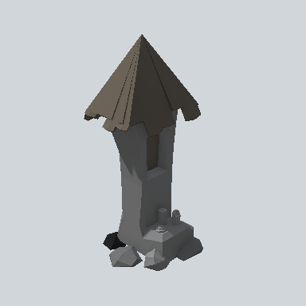 | Sign | [EA03_Prop_Sign_Chapel_01_PRE](Sign/EA03_Prop_Sign_Chapel_01_PRE.md) | 2.0 x 4.0 x 1.8 | `#464748` | - |
| 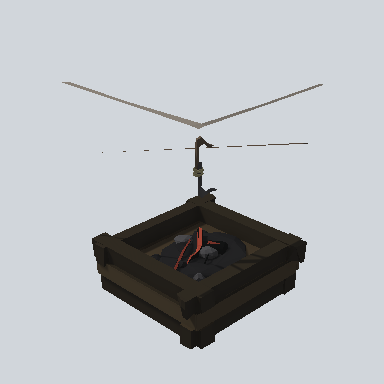 | Village | [EA03_Prop_House_Stove_01b_PRE](Village/EA03_Prop_House_Stove_01b_PRE.md) | 2.8 x 3.3 x 2.7 | `#2E2A22` | - |
| 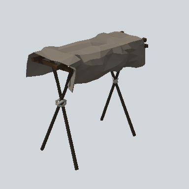 | Village | [EA03_Prop_Stand_Sheet_01a_PRE](Village/EA03_Prop_Stand_Sheet_01a_PRE.md) | 3.6 x 3.3 x 2.0 | `#847A6E` | - |
| 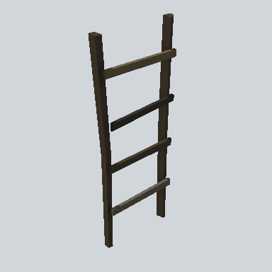 | Village | [EA03_Prop_Village_Ladder_02a_PRE](Village/EA03_Prop_Village_Ladder_02a_PRE.md) | 0.9 x 2.0 x 0.2 | `#373025` | 2 |
| 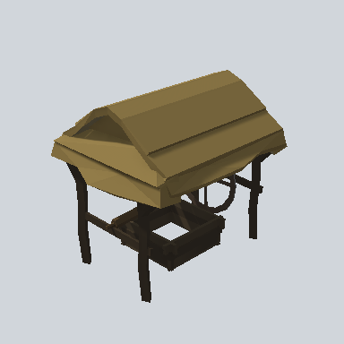 | Village | [EA03_Prop_Village_Whell_01d_PRE](Village/EA03_Prop_Village_Whell_01d_PRE.md) | 5.6 x 4.9 x 4.7 | `#76643B` | - |
| 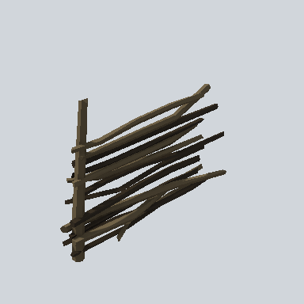 | wooden | [EA03_Fence_Withy_Seam_02a_PRE](wooden/EA03_Fence_Withy_Seam_02a_PRE.md) | 2.3 x 1.7 x 0.6 | `#383125` | - |
|  | wooden | [EA03_Prop_Village_Plank_01c_PRE](wooden/EA03_Prop_Village_Plank_01c_PRE.md) | 0.3 x 1.3 x 0.1 | `#24201B` | - |
|  | wooden | [EA03_Wooden_Pin_01a_PRE](wooden/EA03_Wooden_Pin_01a_PRE.md) | 0.3 x 0.8 x 0.3 | `#29231D` | - |
| 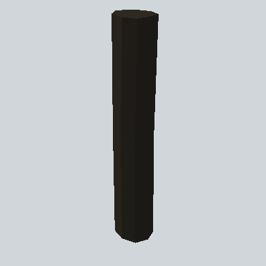 | wooden | [EA03_Wooden_Pin_01b_PRE](wooden/EA03_Wooden_Pin_01b_PRE.md) | 0.2 x 1.5 x 0.3 | `#1C1A16` | - |
| 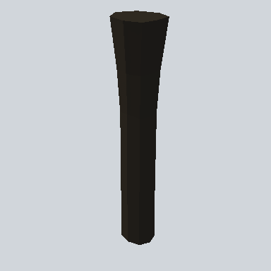 | wooden | [EA03_Wooden_Pin_01c_PRE](wooden/EA03_Wooden_Pin_01c_PRE.md) | 0.3 x 1.8 x 0.4 | `#1B1916` | - |

<!-- PREFAB-INDEX:END -->
