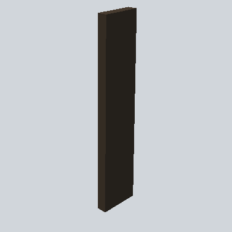

# EA03_Prop_Village_Plank_01c_PRE

Generated by `tools/assets/gen_prefab_tables.py`: edit only below the Notes heading.

| Field | Value |
| --- | --- |
| Pack | EmaceArt-SlavicWorldFree |
| Path | `Prefabs/Prop/wooden/EA03_Prop_Village_Plank_01c_PRE.prefab` |
| GUID | `aec78062b434b6343a8eed8aca8dfded` |
| Subgroup | wooden |
| Size (m) | 1.3 |
| Collider | Mesh |
| LODs | 3 |
| Meshes | `EA03_Prop_Village_Plank_01c.fbx` |
| Materials | `EA03_LPNP-Slavika_Colorsheet_v1.mat` |
| Nested prefabs | none |
| In demo scene | 0 |
| Bounds W x H x D (m) | 0.27 x 1.29 x 0.07 |
| Footprint (m) | 0.3 x 0.1 |
| Pivot | bottom at y = -0.00; center offset x -0.00, z 0.00 |
| Triangles / vertices (LOD0) | 12 / 24 |
| Average color | `#27221C` |
| Dominant colors | `#24201B` 78%, `#332B22` 21%, `#473B2F` 1% |

Colors are read from the rendered preview, so they include lighting. Bounds cover LOD0 renderers.

## Notes

TODO: hand-written usage notes.
