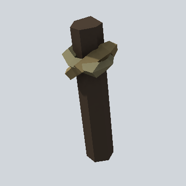

# EA03_Wooden_Pin_01a_PRE

Generated by `tools/assets/gen_prefab_tables.py`: edit only below the Notes heading.

| Field | Value |
| --- | --- |
| Pack | EmaceArt-SlavicWorldFree |
| Path | `Prefabs/Prop/wooden/EA03_Wooden_Pin_01a_PRE.prefab` |
| GUID | `73952e1cfa04b4c4b8752317196d3e09` |
| Subgroup | wooden |
| Size (m) | 0.8 |
| Collider | Mesh |
| LODs | 3 |
| Meshes | `EA03_Wooden_Pin_01a.fbx` |
| Materials | `EA03_LPNP-Slavika_Colorsheet_v1.mat` |
| Nested prefabs | none |
| In demo scene | 0 |
| Bounds W x H x D (m) | 0.31 x 0.81 x 0.27 |
| Footprint (m) | 0.3 x 0.3 |
| Pivot | bottom at y = 0.00; center offset x -0.01, z -0.00 |
| Triangles / vertices (LOD0) | 132 / 274 |
| Average color | `#3C3429` |
| Dominant colors | `#29231D` 47%, `#4E4634` 18%, `#393027` 16% |

Colors are read from the rendered preview, so they include lighting. Bounds cover LOD0 renderers.

## Notes

TODO: hand-written usage notes.
