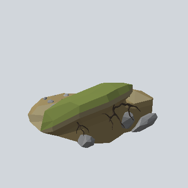
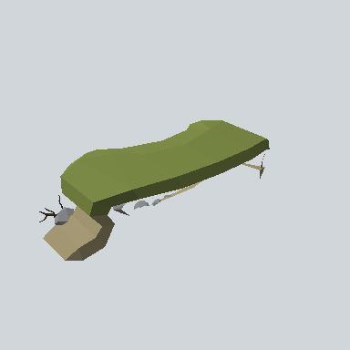
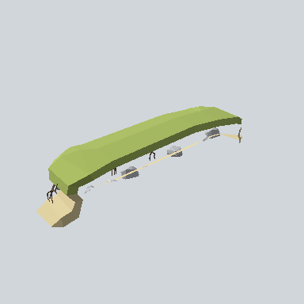
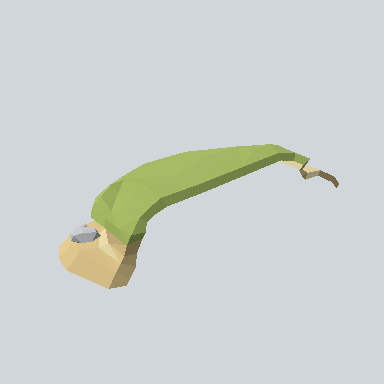

# RiverStraight

**Prefabs: 4**

River **bank** pieces, despite the name. Every prefab has its own card; see [Prefabs](#prefabs).

The previews show no water. Each piece is a grassy bank: an olive-green top
(`#788644` - `#A6B962`), a sandy or earthen face down to the water line
(`#A3956D` - `#D2BB84`), grey stones and bare roots along the foot.

| Prefab | W x H x D (m) | Below pivot (m) | Shape |
| --- | --- | --- | --- |
| `RiverStraight_01f_R` | 20.1 x 8.5 x 20.5 | 1.6 | short, wide bank with a dark earth face and rocks; the only near-square one |
| `RiverStraight_01g` | 35.1 x 9.7 x 16.1 | 2.6 | gently curved bank top over a sandy foot |
| `RiverStraight_02a` | 49.6 x 10.1 x 10.5 | 5.1 | long, narrow, straight bank strip |
| `RiverStraight_02b` | 58.7 x 8.8 x 25.4 | 7.0 | longest; tapers and bends at one end |

All have a mesh collider and LODs. None is used in the demo scene.

## Using it in a map

- A river is two rows of banks facing each other, with a water plane between
  them using `Materials/Water.mat`. The pack has no water surface prefab.
- Each piece is one long run, not a tile, and the pieces differ in length and
  depth, so they do not chain cleanly. `01g` and `02b` already curve a little.
- They sink 1.6 - 7.0 m below their pivot, so the water level sits below the
  ground the pivot stands on. Place the pivot at the bank top.
- They also work as a raised grassy edge along any low ground, such as the
  blue lowland regions of the sample map.

## Gaps

- No water surface, no riverbed, no bend or junction piece, no waterfall.
- `TODO`: check whether two pieces meet without a gap; their ends are uneven.

## Prefabs

<!-- PREFAB-INDEX:START (generated) -->

**4 prefabs**, one card each.

| Preview | Subgroup | Prefab | W x H x D (m) | Main color | In scene |
| --- | --- | --- | --- | --- | --- |
|  | - | [EA03_Environment_RiverStraight_01f_R_PRE](EA03_Environment_RiverStraight_01f_R_PRE.md) | 20.1 x 8.5 x 20.5 | `#4E4731` | - |
|  | - | [EA03_Environment_RiverStraight_01g_PRE](EA03_Environment_RiverStraight_01g_PRE.md) | 35.1 x 9.7 x 16.1 | `#788644` | - |
|  | - | [EA03_Environment_RiverStraight_02a_PRE](EA03_Environment_RiverStraight_02a_PRE.md) | 49.6 x 10.1 x 10.5 | `#A6B962` | - |
|  | - | [EA03_Environment_RiverStraight_02b_PRE](EA03_Environment_RiverStraight_02b_PRE.md) | 58.7 x 8.8 x 25.4 | `#A5B864` | - |

<!-- PREFAB-INDEX:END -->
