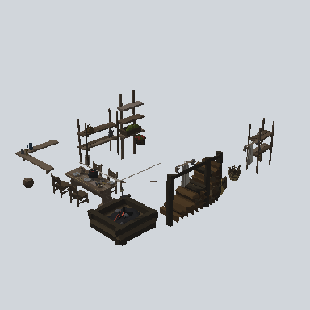

# EA_Room_Int_Kitchen_Comp_7x10_01a_PRE

Generated by `tools/assets/gen_prefab_tables.py`: edit only below the Notes heading.

| Field | Value |
| --- | --- |
| Pack | EmaceArt-SlavicWorldFree |
| Path | `Prefabs/EA_Room_Int_Kitchen_Comp_7x10_01a_PRE.prefab` |
| GUID | `dde4e20405bbdff44a7a8e57f9f6eab8` |
| Subgroup | - |
| Size (m) | unknown (no LOD group) |
| Collider | none |
| LODs | none |
| Meshes | none found |
| Materials | none found |
| Nested prefabs | `EA03_Items_House_Apple_01c_PRE`, `EA03_Items_House_Besom_01a_PRE`, `EA03_Items_House_BredBoard_01a_PRE`, `EA03_Items_House_Firewood_01a_PRE`, `EA03_Prop_Container_Bag_02a_PRE`, `EA03_Prop_Container_Basket_01a_PRE`, `EA03_Prop_Container_Crate_01a_PRE`, `EA03_Prop_House_Hanger_01b_PRE`, `EA03_Prop_House_Shelf_01a_PRE`, `EA03_Prop_House_Shelf_01c_PRE`, `EA03_Prop_House_Shelf_02c_PRE`, `EA03_Prop_House_Stove_01b_PRE`, `EA03_Prop_Shelf_01b_PRE`, `EA03_Prop_Stool_02a_PRE`, `EA03_Prop_Tabble_01a_PRE`, `EA03_Prop_Tool_Basket_01_PRE`, `EA03_Prop_Vegetable_Bag_02_PRE`, `EA03_Prop_Vegetable_Basket_01a_PRE`, `EA_Items_House_bowl_metal_PRE`, `EA_Items_House_bowl_spoon_01a_PRE`, `EA_Items_House_bowl_wod_2_PRE`, `EA_Items_House_bowl_wod_PRE`, `EA_Items_House_bowl_wooden_powder_02a_PRE`, `EA_Items_House_cauldron_01a_PRE`, `EA_Items_House_cauldron_01d_PRE`, `EA_Items_House_cauldron_soup_01a_PRE`, `EA_Items_House_kettle_01a_PRE`, `EA_Items_House_kettle_empty_01a_PRE`, `EA_Items_House_mug_01a_PRE`, `EA_Items_House_mug_01b_PRE`, `EA_Items_House_mug_02a_PRE`, `EA_Items_House_pan_empty_01a_PRE`, `EA_Items_House_spoon_wooden_02_PRE`, `EA_Items_House_spoon_wooden_03_PRE`, `EA_Items_House_spoon_wooden_04_PRE`, `EA_Items_House_spoon_wooden_05_PRE` |
| In demo scene | 1 |
| Bounds W x H x D (m) | 10.65 x 3.73 x 7.60 |
| Footprint (m) | 10.6 x 7.6 |
| Pivot | bottom at y = -0.72; center offset x 0.04, z 0.59 |
| Triangles / vertices (LOD0) | 13,824 / 23,313 |
| Average color | `#342D25` |
| Dominant colors | `#312B24` 25%, `#2A241B` 21%, `#1A1815` 17% |

Colors are read from the rendered preview, so they include lighting. Bounds cover LOD0 renderers.

## Notes

TODO: hand-written usage notes.
