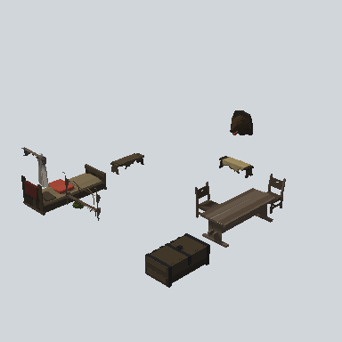

# EA_Room_Int_LivingRoom_Comp_7x7_01a_PRE

Generated by `tools/assets/gen_prefab_tables.py`: edit only below the Notes heading.

| Field | Value |
| --- | --- |
| Pack | EmaceArt-SlavicWorldFree |
| Path | `Prefabs/EA_Room_Int_LivingRoom_Comp_7x7_01a_PRE.prefab` |
| GUID | `ba5f2411d6356e74f960d5b2dd2d1c77` |
| Subgroup | - |
| Size (m) | unknown (no LOD group) |
| Collider | none |
| LODs | none |
| Meshes | none found |
| Materials | none found |
| Nested prefabs | `EA03_Prop_Container_Chest_02a_PRE`, `EA03_Prop_House_Hanger_01b_PRE`, `EA03_Prop_House_Shelf_01g_PRE`, `EA03_Prop_Pillow_01d_PRE`, `EA03_Prop_Stool_02a_PRE`, `EA03_Prop_Tabble_01a_PRE`, `EA03_Prop_Town_Bed_01a.004_PRE`, `EA03_Prop_Town_Bench_01a_PRE`, `EA03_Prop_Town_Bench_01b_PRE`, `EA_Prop_Hunter_Animal_Trophy_01a_PRE` |
| In demo scene | 1 |
| Bounds W x H x D (m) | 7.54 x 2.36 x 6.98 |
| Footprint (m) | 7.5 x 7.0 |
| Pivot | bottom at y = -0.01; center offset x -0.01, z 0.53 |
| Triangles / vertices (LOD0) | 4,126 / 7,631 |
| Average color | `#41362C` |
| Dominant colors | `#322C24` 22%, `#42382B` 15%, `#241D18` 14% |

Colors are read from the rendered preview, so they include lighting. Bounds cover LOD0 renderers.

## Notes

TODO: hand-written usage notes.
