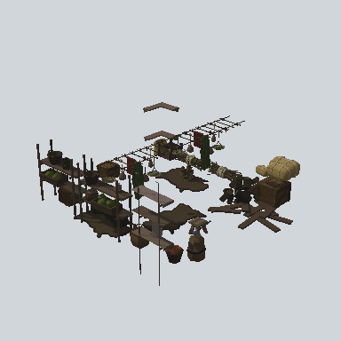
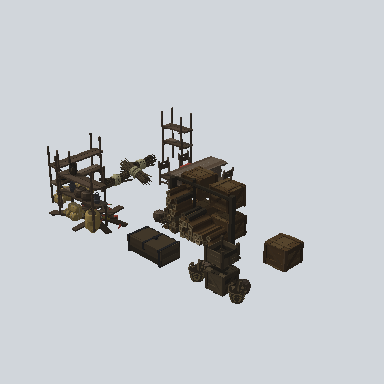
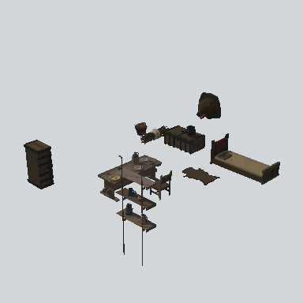

# Rooms

**Prefabs: 5**

Pre-composed interior rooms at the root of `Prefabs/`. Every prefab has its own card; see [Prefabs](#prefabs).

| Prefab | Note |
| --- | --- |
| `EA_Room_Comp_3X3` | 3 x 3 room |
| `EA_Room_Int_Kitchen_Comp_7x10_01a` | 7 x 10 kitchen; one in the scene |
| `EA_Room_Int_LivingRoom_Comp_7x7_01a/b/c` | 7 x 7 living rooms; `01a` is in the scene |

They have no LOD group and no root collider; dimensions come from the names.

## Using it in a map

- Interiors are out of scope for the outdoor map pipeline. Keep for later if
  buildings need to be enterable.
- `Rooms` is a name given to the files at the root of `Prefabs/`; it is not a
  folder in the pack.

## Prefabs

<!-- PREFAB-INDEX:START (generated) -->

**5 prefabs**, one card each.

| Preview | Subgroup | Prefab | W x H x D (m) | Main color | In scene |
| --- | --- | --- | --- | --- | --- |
|  | - | [EA_Room_Comp_3X3_PRE](EA_Room_Comp_3X3_PRE.md) | 7.5 x 3.7 x 8.6 | `#2A241B` | - |
|  | - | [EA_Room_Int_Kitchen_Comp_7x10_01a_PRE](EA_Room_Int_Kitchen_Comp_7x10_01a_PRE.md) | 10.6 x 3.7 x 7.6 | `#312B24` | 1 |
|  | - | [EA_Room_Int_LivingRoom_Comp_7x7_01a_PRE](EA_Room_Int_LivingRoom_Comp_7x7_01a_PRE.md) | 7.5 x 2.4 x 7.0 | `#322C24` | 1 |
|  | - | [EA_Room_Int_LivingRoom_Comp_7x7_01b_PRE](EA_Room_Int_LivingRoom_Comp_7x7_01b_PRE.md) | 7.4 x 2.7 x 10.6 | `#2B241B` | - |
|  | - | [EA_Room_Int_LivingRoom_Comp_7x7_01c_PRE](EA_Room_Int_LivingRoom_Comp_7x7_01c_PRE.md) | 7.6 x 3.7 x 7.3 | `#322C25` | - |

<!-- PREFAB-INDEX:END -->
