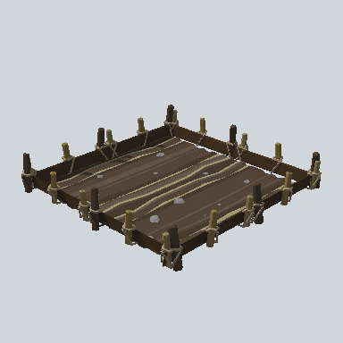
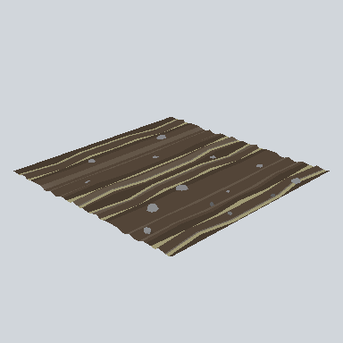

# Terrain

**Prefabs: 2**

Field ground tiles. Every prefab has its own card; see [Prefabs](#prefabs).

| Prefab | W x H x D (m) | Collider | Looks like |
| --- | --- | --- | --- |
| `Environment_Field_Comp_01a` | 5.4 x 1.0 x 5.4 | none | a small plowed plot inside a post-and-rope fence; 4.8 k triangles |
| `Terrain_Field_2x2_Seam_01a` | 20.0 x 0.6 x 20.0 | Mesh | a plowed field: dark brown furrows (`#524437`) with tan seams and a few stones |

Neither appears in the demo scene. The demo ground is a Unity `Terrain`
(`Terrain/SLAVICA FREE TERRAIN.asset`, outside `Prefabs/`).

## Using it in a map

- The 20 m field tile tiles into farmland: it is flat and square, the only
  prefab in the pack that does. Everything else in a region needs terrain.
- `Field_Comp_01a` is a garden plot for next to huts, not a ground tile.
- Region ground otherwise comes from a Unity `Terrain` with the tiling
  textures in `Texture/`.
- `TODO`: read the demo `TerrainData` (size, resolution, terrain layers) with an
  Editor script and record it in the pack README.

## Prefabs

<!-- PREFAB-INDEX:START (generated) -->

**2 prefabs**, one card each.

| Preview | Subgroup | Prefab | W x H x D (m) | Main color | In scene |
| --- | --- | --- | --- | --- | --- |
|  | Field | [EA03_Environment_Field_Comp_01a](Field/EA03_Environment_Field_Comp_01a.md) | 5.4 x 1.0 x 5.4 | `#514436` | - |
|  | Field | [EA03_Terrain_Field_2x2_Seam_01a_PRE](Field/EA03_Terrain_Field_2x2_Seam_01a_PRE.md) | 20.0 x 0.6 x 20.0 | `#524437` | - |

<!-- PREFAB-INDEX:END -->
