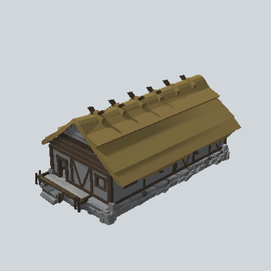

# EA03_Town_House_Comp_02a_PRE

Generated by `tools/assets/gen_prefab_tables.py`: edit only below the Notes heading.

| Field | Value |
| --- | --- |
| Pack | EmaceArt-SlavicWorldFree |
| Path | `Prefabs/Town/Building/EA03_Town_House_Comp_02a_PRE.prefab` |
| GUID | `8df3daf84b58c4b4bb283bcedf5d9d62` |
| Subgroup | Building |
| Size (m) | unknown (no LOD group) |
| Collider | none |
| LODs | none |
| Meshes | `EA03_Village_Hut_Roof_Cut_01a.fbx` |
| Materials | `EA03_LPNP-Slavika_Colorsheet_v1.mat` |
| Nested prefabs | `EA03_Town_Hut_Foundation_02b_PRE`, `EA03_Town_Hut_Wall_Front_04b_PRE`, `EA03_Town_Hut_Wall_Front_04e_PRE 1`, `EA03_Town_Hut_Wall_Front_04h_PRE`, `EA03_Village_HouseModule_Porch_01d_PRE`, `EA03_Village_Hut_Ceiling_01e_PRE`, `EA03_Village_Hut_Wall_Front_04f_PRE` |
| In demo scene | 0 |
| Bounds W x H x D (m) | 18.75 x 8.25 x 11.30 |
| Footprint (m) | 18.8 x 11.3 |
| Pivot | bottom at y = -4.13; center offset x 0.13, z 0.00 |
| Triangles / vertices (LOD0) | 4,844 / 9,852 |
| Average color | `#61563E` |
| Dominant colors | `#75643B` 23%, `#494A4B` 13%, `#695935` 13% |

Colors are read from the rendered preview, so they include lighting. Bounds cover LOD0 renderers.

## Notes

TODO: hand-written usage notes.
