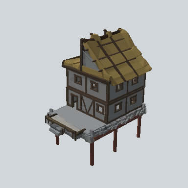

# EA03_Town_House_Comp_03a_PRE

Generated by `tools/assets/gen_prefab_tables.py`: edit only below the Notes heading.

| Field | Value |
| --- | --- |
| Pack | EmaceArt-SlavicWorldFree |
| Path | `Prefabs/Town/Building/EA03_Town_House_Comp_03a_PRE.prefab` |
| GUID | `22585a2e94d83b7478b76483455dbd91` |
| Subgroup | Building |
| Size (m) | unknown (no LOD group) |
| Collider | none |
| LODs | none |
| Meshes | none found |
| Materials | none found |
| Nested prefabs | `EA03_Town_Hut_Foundation_02b_PRE`, `EA03_Town_Hut_Wall_Front_04b_PRE`, `EA03_Town_Hut_Wall_Front_04e_PRE 1`, `EA03_Town_Hut_Wall_Front_04h_PRE`, `EA03_Town_Hut_Wall_Painted_Desk_02a_PRE`, `EA03_Village_HouseModule_Porch_01d_PRE`, `EA03_Village_Hut_Roof_Half_01a_PRE`, `EA03_Village_Hut_Wall_Front_04f_PRE` |
| In demo scene | 0 |
| Bounds W x H x D (m) | 14.51 x 16.72 x 10.15 |
| Footprint (m) | 14.5 x 10.1 |
| Pivot | bottom at y = -4.44; center offset x -0.14, z -0.09 |
| Triangles / vertices (LOD0) | 5,667 / 11,759 |
| Average color | `#585144` |
| Dominant colors | `#382D25` 19%, `#494A4A` 14%, `#686869` 13% |

Colors are read from the rendered preview, so they include lighting. Bounds cover LOD0 renderers.

## Notes

TODO: hand-written usage notes.
