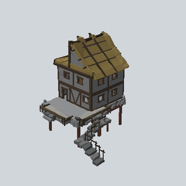

# EA03_Town_House_Comp_03b_PRE

Generated by `tools/assets/gen_prefab_tables.py`: edit only below the Notes heading.

| Field | Value |
| --- | --- |
| Pack | EmaceArt-SlavicWorldFree |
| Path | `Prefabs/Town/Building/EA03_Town_House_Comp_03b_PRE.prefab` |
| GUID | `94f76ea580cc3594e940ce929301f400` |
| Subgroup | Building |
| Size (m) | unknown (no LOD group) |
| Collider | none |
| LODs | none |
| Meshes | none found |
| Materials | none found |
| Nested prefabs | `EA03_Environment_Road_Cobble_Staris_01b_PRE`, `EA03_Town_Hut_Foundation_02b_PRE`, `EA03_Town_Hut_Wall_Front_04b_PRE`, `EA03_Town_Hut_Wall_Front_04e_PRE 1`, `EA03_Town_Hut_Wall_Front_04h_PRE`, `EA03_Town_Hut_Wall_Painted_Desk_02a_PRE`, `EA03_Village_HouseModule_Porch_01d_PRE`, `EA03_Village_Hut_Ceiling_01e_PRE`, `EA03_Village_Hut_Roof_Half_01a_PRE`, `EA03_Village_Hut_Wall_Front_04f_PRE` |
| In demo scene | 0 |
| Bounds W x H x D (m) | 14.69 x 16.72 x 16.20 |
| Footprint (m) | 14.7 x 16.2 |
| Pivot | bottom at y = -4.44; center offset x 0.05, z 2.95 |
| Triangles / vertices (LOD0) | 7,812 / 16,076 |
| Average color | `#585145` |
| Dominant colors | `#382F28` 19%, `#696A6A` 15%, `#74633A` 14% |

Colors are read from the rendered preview, so they include lighting. Bounds cover LOD0 renderers.

## Notes

TODO: hand-written usage notes.
