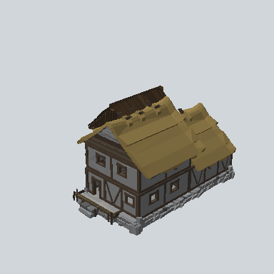

# EA03_Town_House_Comp_03c_PRE

Generated by `tools/assets/gen_prefab_tables.py`: edit only below the Notes heading.

| Field | Value |
| --- | --- |
| Pack | EmaceArt-SlavicWorldFree |
| Path | `Prefabs/Town/Building/EA03_Town_House_Comp_03c_PRE.prefab` |
| GUID | `127ca850a4457ad4b913ff6f1383d396` |
| Subgroup | Building |
| Size (m) | unknown (no LOD group) |
| Collider | none |
| LODs | none |
| Meshes | none found |
| Materials | none found |
| Nested prefabs | `EA03_Town_Hut_Foundation_02b_PRE`, `EA03_Town_Hut_Wall_Front_04b_PRE`, `EA03_Town_Hut_Wall_Front_04e_PRE`, `EA03_Town_Hut_Wall_Front_04e_PRE 1`, `EA03_Town_Hut_Wall_Front_04h_PRE`, `EA03_Village_HouseModule_Porch_01d_PRE`, `EA03_Village_Hut_Ceiling_01e_PRE`, `EA03_Village_Hut_Roof_Cut_01c_PRE`, `EA03_Village_Hut_Roof_Cut_01d_PRE`, `EA03_Village_Hut_Wall_Front_04f_PRE`, `EA_Roof_01a_PRE` |
| In demo scene | 0 |
| Bounds W x H x D (m) | 19.63 x 11.40 x 18.51 |
| Footprint (m) | 19.6 x 18.5 |
| Pivot | bottom at y = -0.00; center offset x 0.00, z 0.11 |
| Triangles / vertices (LOD0) | 12,926 / 25,780 |
| Average color | `#5C523F` |
| Dominant colors | `#75643B` 22%, `#484849` 13%, `#2D251D` 12% |

Colors are read from the rendered preview, so they include lighting. Bounds cover LOD0 renderers.

## Notes

TODO: hand-written usage notes.
