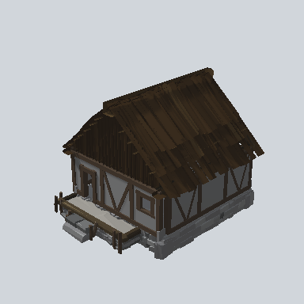
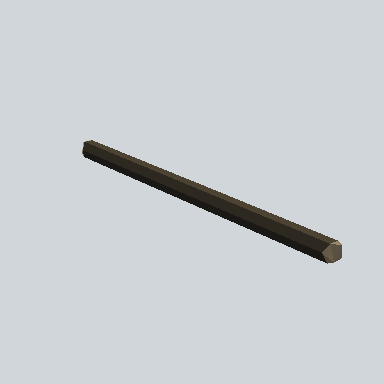

# Town

**Prefabs: 10**

Town buildings. Every prefab has its own card; see [Prefabs](#prefabs).

| Subgroup | Count | Size (m) | Note |
| --- | --- | --- | --- |
| `Administrative` | 3 | 20.6 - 23.1 wide, 8 - 11 tall | long log halls on a grey stone plinth with dark plank roofs; `01c` has a tan roof. 13.6 k - 17.6 k triangles |
| `Building` | 5 | 11.5 - 19.6 wide, 8 - 17 tall | `Town_House_Comp_*`: half-timbered houses (white walls, dark beams, plank roof, stone base, porch), assembled from nested `Compound` parts |
| `Compound/Walls_Painted` | 2 | 8.5 long | thin painted wall trims, 40 triangles |

## Using it in a map

- These are the largest, most detailed buildings in the pack: a town square or
  hub reads well with one administrative hall and a few houses.
- `Town_House_Comp_02a`, `03a`, `03b` extend 4.1 - 4.4 m below their pivot
  (deep stone bases), so they suit sloped ground; place the pivot at the
  doorway level.
- The house roots have no collider; the nested parts carry them (see each
  card's Nested prefabs row). They are the worked examples of how `Compound`
  parts snap together.

## Gaps

- `TODO`: front direction of each building, for placing along a road.

## Prefabs

<!-- PREFAB-INDEX:START (generated) -->

**10 prefabs**, one card each.

| Preview | Subgroup | Prefab | W x H x D (m) | Main color | In scene |
| --- | --- | --- | --- | --- | --- |
|  | Administrative | [EA03_Town_Building_Administrative _01a_PRE](Administrative/EA03_Town_Building_Administrative%20_01a_PRE.md) | 20.6 x 11.3 x 11.9 | `#2F251A` | - |
|  | Administrative | [EA03_Town_Building_Administrative _01b_Modular_PRE](Administrative/EA03_Town_Building_Administrative%20_01b_Modular_PRE.md) | 20.9 x 10.8 x 11.2 | `#30261B` | 1 |
|  | Administrative | [EA03_Town_Building_Administrative _01c_PRE](Administrative/EA03_Town_Building_Administrative%20_01c_PRE.md) | 23.1 x 8.2 x 11.3 | `#77653C` | - |
|  | Building | [EA03_Town_House_Comp_01a_PRE](Building/EA03_Town_House_Comp_01a_PRE.md) | 11.5 x 8.6 x 9.9 | `#2F251B` | - |
|  | Building | [EA03_Town_House_Comp_02a_PRE](Building/EA03_Town_House_Comp_02a_PRE.md) | 18.8 x 8.3 x 11.3 | `#75643B` | - |
|  | Building | [EA03_Town_House_Comp_03a_PRE](Building/EA03_Town_House_Comp_03a_PRE.md) | 14.5 x 16.7 x 10.1 | `#382D25` | - |
|  | Building | [EA03_Town_House_Comp_03b_PRE](Building/EA03_Town_House_Comp_03b_PRE.md) | 14.7 x 16.7 x 16.2 | `#382F28` | - |
|  | Building | [EA03_Town_House_Comp_03c_PRE](Building/EA03_Town_House_Comp_03c_PRE.md) | 19.6 x 11.4 x 18.5 | `#75643B` | - |
|  | Compound/Walls_Painted | [EA03_Town_Hut_Wall_Painted_Desk_02a_PRE](Compound/Walls_Painted/EA03_Town_Hut_Wall_Painted_Desk_02a_PRE.md) | 0.5 x 0.4 x 8.5 | `#70453A` | - |
|  | Compound/Walls_Painted | [EA03_Village_Hut_Wall_Desk_02a_PRE](Compound/Walls_Painted/EA03_Village_Hut_Wall_Desk_02a_PRE.md) | 0.5 x 0.4 x 8.5 | `#2D2820` | - |

<!-- PREFAB-INDEX:END -->
