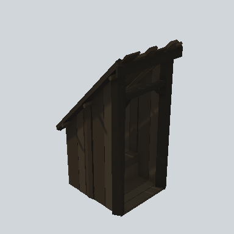

# EA03_Village_OutBuilding_Convenience_01a_PRE

Generated by `tools/assets/gen_prefab_tables.py`: edit only below the Notes heading.

| Field | Value |
| --- | --- |
| Pack | EmaceArt-SlavicWorldFree |
| Path | `Prefabs/Village/Building/Other/EA03_Village_OutBuilding_Convenience_01a_PRE.prefab` |
| GUID | `ea1570d0256864e4c8563689a8122aa8` |
| Subgroup | Building/Other |
| Size (m) | 4.8 |
| Collider | Mesh |
| LODs | 3 |
| Meshes | `EA03_Village_OutBuilding_Convenience_01a.fbx` |
| Materials | `EA03_LPNP-Slavika_Colorsheet_v1.mat` |
| Nested prefabs | none |
| In demo scene | 1 |
| Bounds W x H x D (m) | 2.64 x 4.76 x 2.91 |
| Footprint (m) | 2.6 x 2.9 |
| Pivot | bottom at y = -0.02; center offset x 0.00, z 0.00 |
| Triangles / vertices (LOD0) | 532 / 1,034 |
| Average color | `#24201A` |
| Dominant colors | `#1B1915` 42%, `#2A241D` 30%, `#211D18` 14% |

Colors are read from the rendered preview, so they include lighting. Bounds cover LOD0 renderers.

## Notes

TODO: hand-written usage notes.
