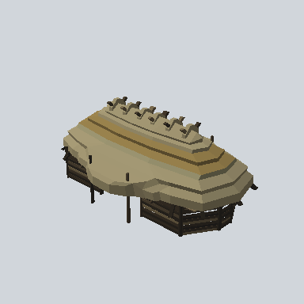

# EA03_Village_OutBuilding_Shed_03b_PRE

Generated by `tools/assets/gen_prefab_tables.py`: edit only below the Notes heading.

| Field | Value |
| --- | --- |
| Pack | EmaceArt-SlavicWorldFree |
| Path | `Prefabs/Village/Building/Shed/EA03_Village_OutBuilding_Shed_03b_PRE.prefab` |
| GUID | `c87007dce4305604eb0e7a8b8aebaee3` |
| Subgroup | Building/Shed |
| Size (m) | 24.5 |
| Collider | Mesh |
| LODs | 3 |
| Meshes | `EA03_Village_OutBuilding_Shed_03b.fbx` |
| Materials | `EA03_LPNP-Slavika_Colorsheet_v1.mat` |
| Nested prefabs | none |
| In demo scene | 0 |
| Bounds W x H x D (m) | 15.45 x 9.51 x 24.47 |
| Footprint (m) | 15.4 x 24.5 |
| Pivot | bottom at y = 0.00; center offset x -0.00, z 0.00 |
| Triangles / vertices (LOD0) | 3,091 / 6,483 |
| Average color | `#766C4F` |
| Dominant colors | `#A29773` 23%, `#968C6B` 16%, `#524A36` 12% |

Colors are read from the rendered preview, so they include lighting. Bounds cover LOD0 renderers.

## Notes

TODO: hand-written usage notes.
