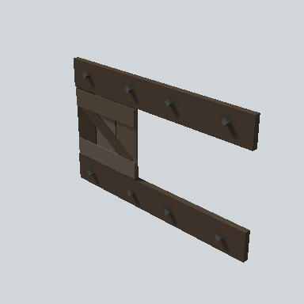

# EA03_Prop_House_Shutter_01d_PRE

Generated by `tools/assets/gen_prefab_tables.py`: edit only below the Notes heading.

| Field | Value |
| --- | --- |
| Pack | EmaceArt-SlavicWorldFree |
| Path | `Prefabs/Village/Elements/EA03_Prop_House_Shutter_01d_PRE.prefab` |
| GUID | `06a8d51f3d3b2824a924b5fd11f46453` |
| Subgroup | Elements |
| Size (m) | 2.2 |
| Collider | Mesh |
| LODs | 3 |
| Meshes | `EA03_Prop_House_Shutter_01d.fbx` |
| Materials | `EA03_LPNP-Slavika_Colorsheet_v1.mat` |
| Nested prefabs | none |
| In demo scene | 0 |
| Bounds W x H x D (m) | 0.11 x 1.32 x 2.17 |
| Footprint (m) | 0.1 x 2.2 |
| Pivot | bottom at y = -0.66; center offset x 0.05, z -0.00 |
| Triangles / vertices (LOD0) | 176 / 352 |
| Average color | `#3E342C` |
| Dominant colors | `#3B3128` 71%, `#473D33` 9%, `#4F4741` 8% |

Colors are read from the rendered preview, so they include lighting. Bounds cover LOD0 renderers.

## Notes

TODO: hand-written usage notes.
