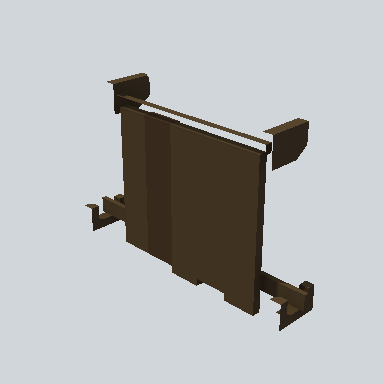

# EA03_Prop_House_Shutter_01e_PRE

Generated by `tools/assets/gen_prefab_tables.py`: edit only below the Notes heading.

| Field | Value |
| --- | --- |
| Pack | EmaceArt-SlavicWorldFree |
| Path | `Prefabs/Village/Elements/EA03_Prop_House_Shutter_01e_PRE.prefab` |
| GUID | `1476b9a23d1668b4b8a13d9478600734` |
| Subgroup | Elements |
| Size (m) | 1.9 |
| Collider | Mesh |
| LODs | 3 |
| Meshes | `EA03_Prop_House_Shutter_01e.fbx` |
| Materials | `EA03_LPNP-Slavika_Colorsheet_v1.mat` |
| Nested prefabs | none |
| In demo scene | 0 |
| Bounds W x H x D (m) | 0.38 x 1.23 x 1.86 |
| Footprint (m) | 0.4 x 1.9 |
| Pivot | bottom at y = -0.61; center offset x 0.04, z 0.02 |
| Triangles / vertices (LOD0) | 220 / 400 |
| Average color | `#3B2E1F` |
| Dominant colors | `#3E3120` 60%, `#31271A` 29%, `#55442C` 5% |

Colors are read from the rendered preview, so they include lighting. Bounds cover LOD0 renderers.

## Notes

TODO: hand-written usage notes.
