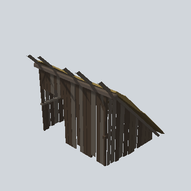

# EA03_Village_OutBuilding_PentHouse_01a_PRE

Generated by `tools/assets/gen_prefab_tables.py`: edit only below the Notes heading.

| Field | Value |
| --- | --- |
| Pack | EmaceArt-SlavicWorldFree |
| Path | `Prefabs/Village/OutBuilding/EA03_Village_OutBuilding_PentHouse_01a_PRE.prefab` |
| GUID | `e2f8c4b2f75e8c24e87456a8117a1508` |
| Subgroup | OutBuilding |
| Size (m) | 10.5 |
| Collider | Mesh |
| LODs | 3 |
| Meshes | `EA03_Village_OutBuilding_PentHouse_01a.fbx` |
| Materials | `EA03_LPNP-Slavika_Colorsheet_v1.mat` |
| Nested prefabs | none |
| In demo scene | 0 |
| Bounds W x H x D (m) | 9.27 x 8.81 x 10.38 |
| Footprint (m) | 9.3 x 10.4 |
| Pivot | bottom at y = -0.00; center offset x -1.06, z 0.25 |
| Triangles / vertices (LOD0) | 609 / 1,293 |
| Average color | `#3B342C` |
| Dominant colors | `#38312A` 53%, `#2A231D` 23%, `#524B43` 17% |

Colors are read from the rendered preview, so they include lighting. Bounds cover LOD0 renderers.

## Notes

TODO: hand-written usage notes.
