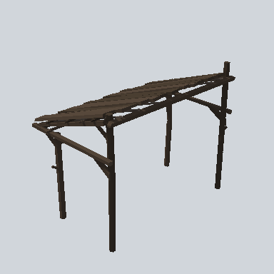

# EA03_Village_OutBuilding_WoodRoof_01b_PRE

Generated by `tools/assets/gen_prefab_tables.py`: edit only below the Notes heading.

| Field | Value |
| --- | --- |
| Pack | EmaceArt-SlavicWorldFree |
| Path | `Prefabs/Village/OutBuilding/EA03_Village_OutBuilding_WoodRoof_01b_PRE.prefab` |
| GUID | `a5137eb5b70ccf847baddb5765b278a4` |
| Subgroup | OutBuilding |
| Size (m) | 5.2 |
| Collider | Mesh |
| LODs | 3 |
| Meshes | `EA03_Village_OutBuilding_WoodRoof_01b.fbx` |
| Materials | `EA03_LPNP-Slavika_Colorsheet_v1.mat` |
| Nested prefabs | none |
| In demo scene | 0 |
| Bounds W x H x D (m) | 5.17 x 4.16 x 3.21 |
| Footprint (m) | 5.2 x 3.2 |
| Pivot | bottom at y = 0.00; center offset x -0.14, z -0.10 |
| Triangles / vertices (LOD0) | 784 / 1,536 |
| Average color | `#372E26` |
| Dominant colors | `#27221D` 31%, `#352C25` 29%, `#493D30` 16% |

Colors are read from the rendered preview, so they include lighting. Bounds cover LOD0 renderers.

## Notes

TODO: hand-written usage notes.
