# Village

**Prefabs: 17**

Finished village buildings and attachments. Every prefab has its own card; see [Prefabs](#prefabs).

| Subgroup | Count | Size (m) | What it is |
| --- | --- | --- | --- |
Sizes are measured W x H x D in meters.

| Subgroup | Count | What it looks like |
| --- | --- | --- |
| `Building/Other` | 5 | `Village_Tover_01a`: 8.1 x 10.9 x 8.8 log watchtower with a pyramid shingle roof; `OutBuilding_Cubby_01d`: 9.0 x 8.5 x 7.3 log hut with a tan thatch roof (2 in the scene); two outhouses (`Convenience`, 2.6 - 2.9 m wide; `Bld_..._01a` is 10.4 m tall with 5.2 m below its pivot); `EA_Roof_01a`, a loose 9.3 x 9.9 roof |
| `Building/Shed` | 1 | `OutBuilding_Shed_03b`: 15.4 x 9.5 x 24.5 m long hall with a tan thatch roof, the largest building in the pack |
| `Building/Porch` | 1 | 6.6 x 2.9 m porch, mostly grey (`#9A9892`) |
| `Building/Compound/Walls` | 1 | one 5.4 m log wall |
| `OutBuilding` | 3 | dark plank sheds: `Shed_01a` (11.1 x 8.1, an open-sided A-frame), `PentHouse_01a` (9.3 x 10.4), `WoodRoof_01b` (5.2 x 3.2) |
| `Elements` | 5 | shutters (1.9 - 3.0 m) and a bolt; decoration only |
| `Village/AnimalBreeding` | 1 | 2.2 m animal hovel |

## Using it in a map

- These are the place-and-go buildings for village regions: rough log and
  plank, darker and smaller than `Town`. A building is one prefab with a mesh
  collider and LODs.
- A village core can be the thatched hall plus two cubbies and the tower as a
  landmark, with sheds and the hovel around them.
- `Elements` are decoration for other buildings, not standalone.

## Gaps

- `TODO`: building entrances and facing are undocumented. Check pivot and front
  direction in the Editor before auto-placing along a road.

## Prefabs

<!-- PREFAB-INDEX:START (generated) -->

**17 prefabs**, one card each.

| Preview | Subgroup | Prefab | W x H x D (m) | Main color | In scene |
| --- | --- | --- | --- | --- | --- |
| 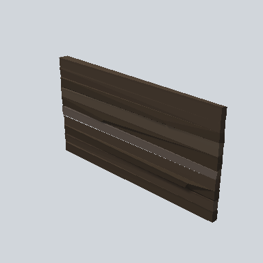 | Building/Compound/Walls | [EA03_Village_Hut_Wall_Front_01i_PRE](Building/Compound/Walls/EA03_Village_Hut_Wall_Front_01i_PRE.md) | 0.3 x 2.9 x 5.4 | `#372E25` | 1 |
| 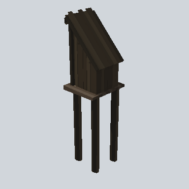 | Building/Other | [EA03_Bld_Village_Convenience_01a_PRE](Building/Other/EA03_Bld_Village_Convenience_01a_PRE.md) | 2.9 x 10.4 x 2.9 | `#29241C` | - |
|  | Building/Other | [EA03_Village_OutBuilding_Convenience_01a_PRE](Building/Other/EA03_Village_OutBuilding_Convenience_01a_PRE.md) | 2.6 x 4.8 x 2.9 | `#1B1915` | 1 |
| 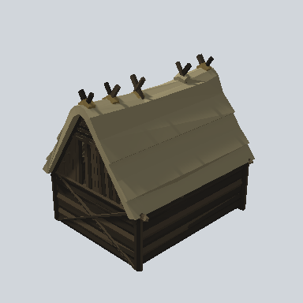 | Building/Other | [EA03_Village_OutBuilding_Cubby_01d_PRE](Building/Other/EA03_Village_OutBuilding_Cubby_01d_PRE.md) | 9.0 x 8.5 x 7.3 | `#5A5542` | 2 |
| 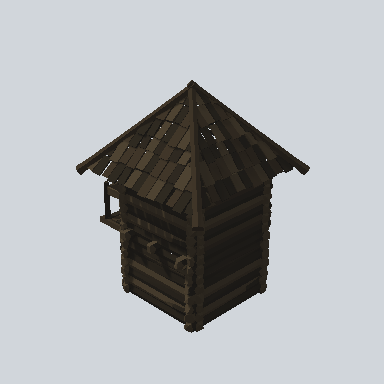 | Building/Other | [EA03_Village_Tover_01a_PRE](Building/Other/EA03_Village_Tover_01a_PRE.md) | 8.1 x 10.9 x 8.8 | `#28231C` | - |
| 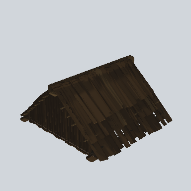 | Building/Other | [EA_Roof_01a_PRE](Building/Other/EA_Roof_01a_PRE.md) | 9.3 x 4.8 x 9.9 | `#30251A` | - |
| 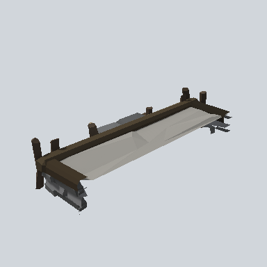 | Building/Porch | [EA03_Village_HouseModule_Porch_01d_PRE](Building/Porch/EA03_Village_HouseModule_Porch_01d_PRE.md) | 6.6 x 1.5 x 2.9 | `#9A9892` | - |
|  | Building/Shed | [EA03_Village_OutBuilding_Shed_03b_PRE](Building/Shed/EA03_Village_OutBuilding_Shed_03b_PRE.md) | 15.4 x 9.5 x 24.5 | `#A29773` | - |
| 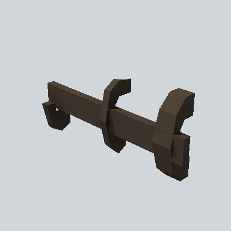 | Elements | [EA03_Prop_House_Bolt_01a_PRE](Elements/EA03_Prop_House_Bolt_01a_PRE.md) | 0.2 x 0.3 x 0.7 | `#392F26` | - |
| 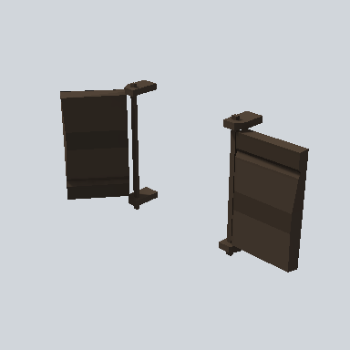 | Elements | [EA03_Prop_House_Shutter_01a_PRE](Elements/EA03_Prop_House_Shutter_01a_PRE.md) | 0.9 x 1.6 x 3.0 | `#28221D` | 1 |
| 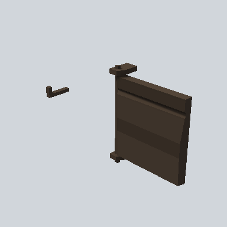 | Elements | [EA03_Prop_House_Shutter_01c_PRE](Elements/EA03_Prop_House_Shutter_01c_PRE.md) | 0.5 x 1.6 x 2.7 | `#393027` | 1 |
|  | Elements | [EA03_Prop_House_Shutter_01d_PRE](Elements/EA03_Prop_House_Shutter_01d_PRE.md) | 0.1 x 1.3 x 2.2 | `#3B3128` | - |
|  | Elements | [EA03_Prop_House_Shutter_01e_PRE](Elements/EA03_Prop_House_Shutter_01e_PRE.md) | 0.4 x 1.2 x 1.9 | `#3E3120` | - |
|  | OutBuilding | [EA03_Village_OutBuilding_PentHouse_01a_PRE](OutBuilding/EA03_Village_OutBuilding_PentHouse_01a_PRE.md) | 9.3 x 8.8 x 10.4 | `#38312A` | - |
| 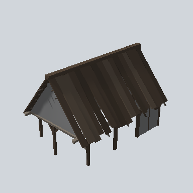 | OutBuilding | [EA03_Village_OutBuilding_Shed_01a_PRE](OutBuilding/EA03_Village_OutBuilding_Shed_01a_PRE.md) | 11.1 x 7.4 x 8.1 | `#342D26` | - |
|  | OutBuilding | [EA03_Village_OutBuilding_WoodRoof_01b_PRE](OutBuilding/EA03_Village_OutBuilding_WoodRoof_01b_PRE.md) | 5.2 x 4.2 x 3.2 | `#27221D` | - |
| 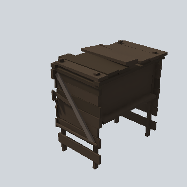 | Village/AnimalBreeding | [EA03_Village_AnimalBreeding_Hovel_01a_PRE](Village/AnimalBreeding/EA03_Village_AnimalBreeding_Hovel_01a_PRE.md) | 2.2 x 2.2 x 2.4 | `#28221D` | - |

<!-- PREFAB-INDEX:END -->
